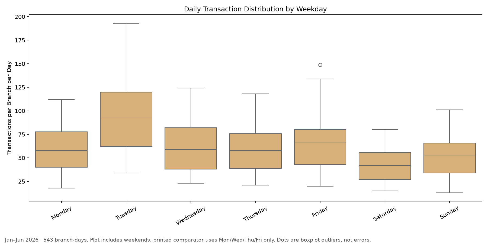
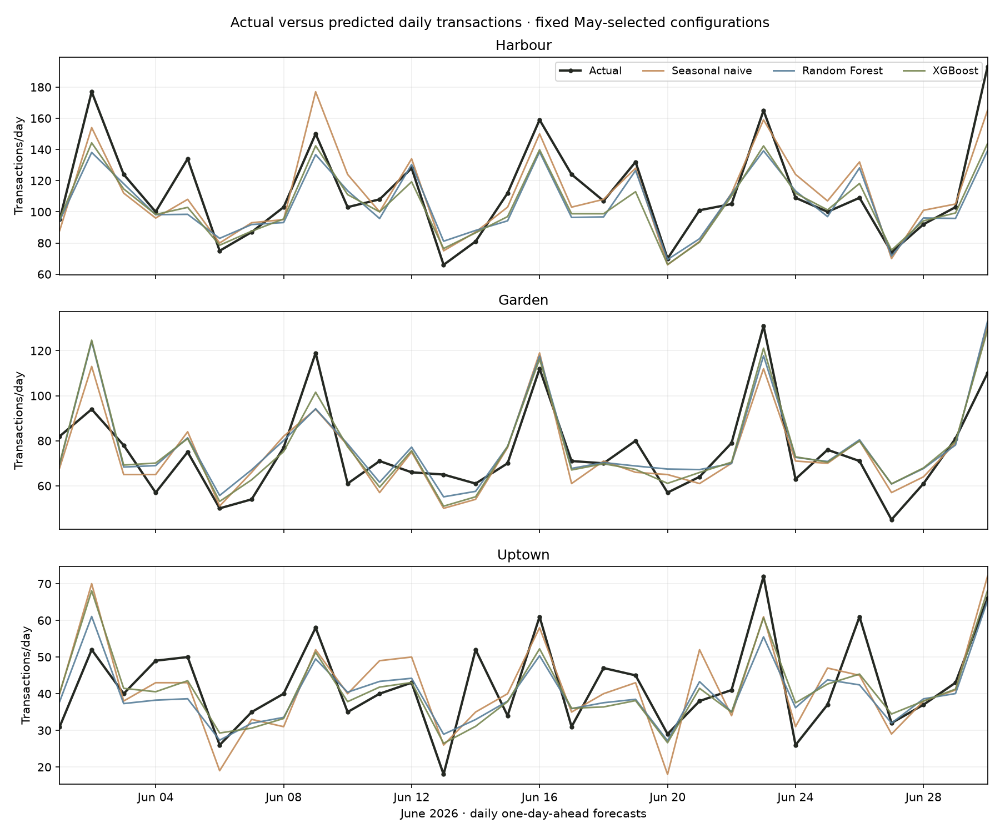

# Stories: Profit Root-Cause Investigation

**Team members:**

- Aya Oueidat — awo01@mail.aub.edu
- Hawraa Salloum — hhs28@mail.aub.edu
- Zahraa Salloum — zhs15@mail.aub.edu

## Conclusion in one paragraph

**The patterns that look like business drivers in this file are mostly fixed settings, not behaviour Stories can act on.** Garden's costs and prices are exact formulas of Harbour's on all 45 products (cost × 1.43, price ÷ 1.05, to the cent). The Tuesday spike (about 1.5× other weekdays) is a uniform multiplier across every branch, hour, product and customer, and real Stories shops show no Tuesday peak. Day-to-day variation is pure chance (dispersion 0.99 against 4.48 for a real shop). So the first action is free: ask Stories how the file and branch standard costs were produced. Dollar value is conditional on that answer: Garden's cost multiplier is worth $0 to $26,000 of July to December gross profit depending on whether it is allocation or cash, a +5% Garden price test is worth up to $6,000 to $8,000 if no customers leave, and a two-bundle pilot is worth about $6,000 to $20,000 a year at 10 to 20% take-up (an assumption, never observed).

## Where to look

1. [Data patterns: which findings are real and which are settings of the data](#data-patterns-and-garden-outlook-notebooks-1011) and [10_data_fingerprints.ipynb](notebooks/10_data_fingerprints.ipynb): the most original result.
2. [Root-cause report](reports/root_cause/REPORT.md) and [executed notebook](notebooks/02_root_cause_investigation.ipynb): why Harbour and Garden differ.
3. [Tuesday external checks](#tuesday-external-checks), [Garden outlook](notebooks/11_garden_profit_outlook.ipynb), [bundle pilots](notebooks/06_bundle_offers.ipynb).

Everything after "Main findings" (demand forecasting steps, hybrid policy, Profit Lab, camera app, week-ahead forecasts) is **supporting work**. It is tested against baselines but does not carry the argument, and none of it is evidence of root cause or extra profit.

**Tuesday ratios, defined once:** 1.535× is Tuesday mean over the mean of Mon/Wed/Thu/Fri branch-days (Step 5); about 1.66 is the calendar-adjusted contrast; 1.52 is the weekday index (Tuesday over the branch's seven-day average). They measure the same spike with different denominators.

## Business objective and evidence boundary

We looked for profit decisions Stories can test, not just predictions. Estimated benefits need controlled pilots before rollout, and nothing here shows that a discount, a location or a conflict caused a change in sales.

**Evidence boundary:** opportunities and exposure are not demonstrated additional profit. Observed accounting, estimated forecasts, hypothetical offer response and simulated disruptions are labelled separately. No causal effect of a discount, location or war is established by this transaction file.

## Location research: why we did it and what management needs to verify

The work/study hypothesis asks whether nearby institutions and visit purpose could explain demand and inform a profitable intervention. We searched public branch listings and found separate Bliss Street/AUB and LeMall Dbayeh contexts, but no verified mapping to Garden/Harbour/Uptown. A nearby institution is not proof of customer identity or Tuesday remote work. We preserve that missing link rather than assign invented locations to forecasts.

Read the [sourced location investigation](reports/root_cause/LOCATION_RESEARCH_AND_SAFE_SOLUTION.md) and [Tuesday purpose check](reports/root_cause/TUESDAY_WORK_STUDY_HYPOTHESIS.md). Management should verify actual branch identity, public-location pins, customer visit purposes and offer eligibility. This matters because an offer aimed at an assumed audience can subsidize existing purchases or attract low-value, capacity-consuming visits. A controlled experiment should measure total GP after costs, not just sales or featured-item purchases.

A location-aware **policy prototype** can suggest hypotheses (for example, university-related pre-order/study demand or mall staff pickup). It is not yet a trained location-response model. Such a model requires a verified branch crosswalk, more independent locations and exposure/response labels. No anonymous branch forecast is assigned to a public case.

## Item-level forecasts, offers and profit-preservation thresholds

[09_item_discount_business_value.ipynb](notebooks/09_item_discount_business_value.ipynb) shows historical unit counts, transaction counts, revenue, GP and GP/unit for all **135 branch/product combinations**. It combines the existing **July 1, 2026 historical forecast** with prices and recorded costs, then evaluates **4,860 explicitly hypothetical discount/quantity scenarios** without retraining. These are historical planning examples, not current forecasts.

[Full report and formulas](reports/item_discount_scenarios/REPORT.md) · [Historical product counts/profit](reports/item_discount_scenarios/historical_product_economics.csv) · [Forecast reference](reports/item_discount_scenarios/forecast_reference.csv) · [All discount scenarios](reports/item_discount_scenarios/discount_scenarios.csv).

For forecast Q, list price P, unit cost C, discount d and assumed unit lift u: reference `G0 = Q(P−C)`; scenario `G1 = Q(1+u)[P(1−d)−C]`. Required units are `G0/[P(1−d)−C]` when the denominator is positive. This reference is full-list-price/no-discount GP, not an estimate of the existing promotion policy. The notebook also shows the maximum discount compatible with an **assumed** unit lift and minimum whole units needed to preserve reference GP.

For example, Garden Chicken Pesto Sandwich at 10% off needs **47.05% additional units** to preserve that reference; an assumed +20% volume would still lower GP. Harbour Iced Latte needs **16.54% additional units**. Neither response is predicted or guaranteed. Positive unit margin is insufficient to protect total GP. Real stockouts, waste, labor, implementation cost, cannibalization and forecast error can reverse a paper gain; a pilot must verify them before rollout. These scenarios must not be added to the separate bundle estimates below.

Reproduce: `python3 src/item_discount_scenarios.py --data /path/to/stories_transactions.csv`; `python3 src/build_item_discount_notebook.py`.

## Main findings

- **Harbour versus Garden:** of the observed $281.54/day gross-profit gap, a symmetric accounting decomposition allocates $145.58/day to transaction counts, $106.80/day to recorded unit costs and $33.59/day to prices, with small offsetting mix, basket-size and discount contributions. These are accounting contributions, not causal effects or recoverable savings.
- **Garden mechanism:** the same products have about 43% higher recorded unit costs and 5% lower prices than Harbour. Product mix does not explain that within-product difference. Cost allocation, actual landed cost and recipes/waste need reconciliation before claiming savings. At Garden's own volumes, the six-month cost-gap sensitivity is $15,923; 25% truly removable would be $3,981 before implementation cost, **conditional on verification**.
- **Tuesday:** the effect persists within weeks, across hours, with illustrative calendar controls and after excluding recorded 15% campaign dates. The adjusted ratio is approximately 1.66, with almost identical mean basket value. The measured mechanism is more transactions, not larger baskets. Payday, hidden promotions, events and data transformations remain competing behavioral explanations; none is proven.
- **Growth:** about 99.6% of the January–June revenue/day accounting increase comes from transaction counts. That does not distinguish footfall, conversion, acquisition or repeat purchases.
- **Tuesday outside the dataset:** real Stories shops in Lebanon show no Tuesday peak in Google Maps popular times (Tuesday index 0.74 to 1.10 across 10 branches, never the busiest day), and a public three-shop benchmark shows none either. This makes a data artifact more likely than a chain-wide driver, without proving it. See [Tuesday: external checks](#tuesday-external-checks).
- **Branch costs and prices are exact formulas:** Garden's unit cost is `round(Harbour cost × 1.43, 2)` and its price `round(Harbour price ÷ 1.05, 2)` on all 45 products, so the Garden cost gap cannot come from product-by-product supplier, recipe or waste differences. Daily sales also vary exactly as much as pure chance predicts, and all branches share one weekday rhythm. See [Data patterns and Garden outlook](#data-patterns-and-garden-outlook-notebooks-1011).
- **Garden outlook:** about $57,000 to $77,000 gross profit in July–December 2026. What the 1.43 multiplier contains is worth $0 to $26,000 of that period's gross profit, against at most about $200 for the discount review.
- **Offers:** two bundles at 10% off are the strongest testable offer (about $6,000 to $20,000 a year at 10 to 20% take-up, a pilot can measure it). See [Offer pilots](#offer-pilots-notebooks-0608).

The source CSV is unchanged. The user's EDA is now in the repository as [notebooks/01_eda.ipynb](notebooks/01_eda.ipynb). Exact duplicates are retained in the primary analysis and checked as a sensitivity; their removal is not automatically justified. Customer first-observed dates and missing IDs are treated cautiously.

## Step 5 — Tuesday versus other working weekdays

Unique transactions are counted per branch/date. **Other weekdays = Monday, Wednesday, Thursday and Friday; weekends are excluded from these comparison values.** There are 78 Tuesday branch-days and 309 comparator branch-days.

| Statistic | Transactions per branch-day |
|---|---:|
| Tuesday mean | 94.846154 |
| Other weekdays mean | 61.796117 |
| Tuesday median | 92.500000 |
| Other weekdays median | 59.000000 |



The Tuesday mean is **1.535×** the comparator; its median is also higher. Each branch separately has higher Tuesday mean and median. The pooled boxplot mixes branch sizes and growth over time, so it does not alone establish persistence or causation. The previously reported 25-of-25 complete-week result provides separate persistence evidence. The earlier approximately 1.66 ratio used a different comparator including weekends (or the documented adjusted geometric contrast); do not interchange these ratios.

[Step 5 interpretation](reports/activity/step5_tuesday_distribution.md) · [Exact values and branch diagnostics](reports/activity/step5_tuesday_distribution.json) · [Branch-stratified boxplots](figures/activity/tuesday_weekday_boxplot_by_branch.png). **No model was trained for this step.**

## Step 6 — Daily transaction forecasting features (no training)

Created [02_demand_forecasting.ipynb](notebooks/02_demand_forecasting.ipynb) and local `daily_demand_features.csv`: **543 observations** (3 branches × 181 calendar dates), **0 missing branch-days**, and **0 missing targets**. Missing feature values: Branch, DayOfWeek, Month, DayOfMonth and Weekend **0 each**; Lag1 **3**; Lag7 **21**; RollingMean7 **21**. These initial history blanks remain in the CSV; 522 rows have all requested history available.

The one-day-ahead forecast is issued after the preceding day closes. Lags are calculated separately within branch on the dense calendar; the shifted rolling average excludes the target date and requires all seven prior dates. Unknown branch-days are not set to zero. Temporal-isolation and missing-day propagation checks passed. No model was trained or selected in this step.

[Full audit and first 15 rows](reports/demand_forecasting/REPORT.md) · [Feature summary](reports/demand_forecasting/feature_summary.json) · [Missing-date list](reports/demand_forecasting/missing_branch_days.csv). Reproduce with `python src/prepare_daily_demand.py --data /path/to/stories_transactions.csv`; regenerate the executed notebook with `STORIES_DATA=/path/to/stories_transactions.csv python src/build_demand_notebook.py`.

## Step 7 — First daily demand models

Executed [03_ml_demand_models.ipynb](notebooks/03_ml_demand_models.ipynb) with train Jan 8–Apr 30 (339 rows), May validation (93) and June test (90). Four fixed Random Forest settings and four fixed XGBoost settings were chosen using May MAE only. Each selected ML pipeline refit Jan 8–May 31 before the final rolling one-day June evaluation. Preprocessing is fitted only on the applicable training period; no June tuning occurs.

| Model | May MAE | June MAE | June RMSE | June WAPE |
|---|---:|---:|---:|---:|
| Seasonal naive | 8.9355 | 9.6000 | 11.6113 | 12.51% |
| Random Forest | 9.1987 | 10.0521 | 13.4934 | 13.10% |
| XGBoost | 8.2523 | 9.1015 | 12.2786 | 11.86% |

**XGBoost was selected on May and has 5.19% lower June MAE than seasonal naive**, but seasonal naive has the better June RMSE and wins Harbour MAE. XGBoost wins Garden and Uptown MAE. Random Forest loses to seasonal naive overall. The paired-date 95% interval for the selected model's MAE improvement is −0.7294 to 1.8134 transactions/day, including zero; the modest observed improvement is not established as reliably generalizable. No branch-specific hybrid is selected from June.



[Full validation/test and branch results](reports/demand_forecasting/STEP7_REPORT.md) · [All eight validation trials](reports/demand_forecasting/validation_search.csv) · [Selection lock](reports/demand_forecasting/selection_lock.json) · [Model manifest](reports/demand_forecasting/best_model_manifest.json). The May-selected model bundle is `artifacts/daily_demand_models/best_model.joblib` (ignored, fit through May 31). Predictions and both ML pipelines are saved alongside it. Reproduce: `python src/train_daily_models.py --data daily_demand_features.csv`; build the executed notebook with `python src/build_ml_demand_notebook.py`. Verify with `python src/verify_daily_models.py`.

MAE/RMSE are transaction counts per branch-day; WAPE is aggregate absolute error divided by observed transactions, not accuracy. June was inspected in earlier project work; this is an internal chronological holdout. These results do not measure a dollar benefit or crisis resilience. Original data and source features are unchanged.

## Step 8 — Does the forecast improvement change the dollars?

Created and executed [04_forecast_business_value.ipynb](notebooks/04_forecast_business_value.ipynb), using frozen Step 7 June predictions and original recorded line gross profit. **No models were retrained; source, saved predictions, selection lock and model hashes are unchanged.**

Prepare nearest-integer transaction-equivalent capacity from each forecast. Nine explicitly hypothetical scenarios combine shortage penalties of 25%/50%/100% of Jan–May branch GP/transaction with excess penalties of 10%/25%/50% of Jan–May recorded input cost/transaction. The oracle has zero shortage/excess cost by construction. Every method uses the same 90 June branch-days; June economics are descriptive, never used to calibrate penalties.

**Seasonal naive has lower overall assumed decision cost in 8/9 scenarios.** XGBoost wins all nine at Garden and Uptown; naive wins all nine at Harbour. Harbour's shortage total increases from 193 to 294 transaction-equivalents under XGBoost, offsetting its reduction in excess preparation. Continuous-capacity sensitivity retains every winner.

| Shortage penalty / historical GP | Excess penalty / historical input cost | Naive total | XGBoost total | Lower assumed cost |
|---|---|---:|---:|---|
| 25% | 50% | $1,375.67 | $1,318.36 | XGBoost by $57.32 |
| 50% | 25% | $1,599.31 | $1,734.80 | Naive by $135.49 |
| 100% | 10% | $2,584.20 | $2,988.57 | Naive by $404.37 |

These are **total June hypothetical decision-cost comparisons, not actual savings** or operating profits. Transaction capacity is a proxy; stockouts, waste, salvage, SKU mix, labor and deployment cost are unobserved. June branch winners may motivate a prospectively validated branch policy, but do not validate selecting a hybrid from the test results.

[All nine scenarios, branch results and assumptions](reports/forecast_business_value/REPORT.md) · [Cost components](reports/forecast_business_value/decision_costs.csv) · [Paired differences](reports/forecast_business_value/model_comparison.csv) · [Historical transaction economics](reports/forecast_business_value/historical_economics.csv). Reproduce without training: `python3 src/forecast_business_value.py --data /path/to/stories_transactions.csv`; build the notebook with `python3 src/build_forecast_business_value_notebook.py`; verify with `python3 src/verify_forecast_business_value.py`.

## Step 9 — Exploratory hybrid forecasting policy

Created and executed [05_hybrid_forecasting_strategy.ipynb](notebooks/05_hybrid_forecasting_strategy.ipynb). Policy A uses seasonal naive everywhere; B uses XGBoost everywhere; C uses naive at Harbour and XGBoost at Garden/Uptown. All use the same saved Step 7 June predictions and nine Step 8 hypothetical cost scenarios. No models were retrained; the original dataset, saved forecasts/models and Step 8 evidence are unchanged.

**The hybrid has lower overall assumed cost in 9/9 scenarios**, improving on all-naive by **$44.65–$182.05**, on all-XGBoost by **$1.09–$572.67**, and on the stronger uniform policy in each scenario by **$1.09–$182.05** over June. Branch-level ties are explicit: hybrid equals naive at Harbour and XGBoost at Garden/Uptown.

**The hybrid was chosen after seeing June. This is a hindsight comparison, not independent validation or proven savings.** It mechanically combines previously observed branch winners. Nine scenarios reuse the same errors; implementation and monitoring costs could consume the modest advantage. The next step is to select/lock branch rules using earlier validation and contemporaneously available economics, then test on genuinely later dates or in a prospective shadow pilot. The report explains why a May selection must use Jan–Apr economics rather than leak Jan–May averages into validation.

[All costs, improvements and methodology](reports/hybrid_forecasting/REPORT.md) · [Comparison CSV](reports/hybrid_forecasting/model_comparison.csv) · [Cost components](reports/hybrid_forecasting/decision_costs.csv) · [Comparison chart](figures/hybrid_forecasting/policy_cost_comparison.png). Reproduce without training: `python3 src/hybrid_forecasting_strategy.py --data /path/to/stories_transactions.csv`; `python3 src/build_hybrid_forecasting_notebook.py`; `python3 src/verify_hybrid_forecasting.py`.

## Profit Lab — Ideas 9–15 implemented

(The interactive Profit Lab page is a private deployment that graders cannot open; everything it shows is in the files below.) [Full evidence and assumptions](reports/profit_lab/REPORT.md) · [Executed notebook](notebooks/04_profit_lab.ipynb) · [Machine-readable results](reports/profit_lab/findings.json).

| Idea | Implementation | What the evidence supports |
|---|---|---|
| 9. Basket completion | Smoothed drink/branch product probabilities; margin-weighted recommendations | June retrieval test; conditional margin rule loses to the simpler popularity margin rule. No proven extra sales. |
| 10. One-dollar challenge | Minimum whole-cent uniform menu price step within each branch; demand-loss sensitivity | At unchanged volume, Harbour +1¢ yields $1.43/day; Garden +2¢ $1.96/day; Uptown +2¢ $1.12/day. Tiny volume losses can erase these gains. |
| 11. Menu alternatives | Same-category purchasing-profile similarity, margin and assumed ingredient filters | Candidate investigation tool; similarity does not establish customer substitution or safe ingredients. |
| 12. Profit at risk | Quantile gradient boosting, May lower-bound calibration, June evaluation | June pinball loss 14.86 versus baseline 20.69; 90% lower-bound coverage. 27 alerts contain only 3 actual low-profit days. |
| 13. Discount review | Recorded discount exposure and margin screening | $2,178.09 exposure, not guaranteed recoverable savings or evidence of ineffective promotions. |
| 14. Portfolio attention | Forecast units × historical realized unit GP versus popularity | Top-three selections capture $4,970.80 of existing June GP versus $4,720.01 for historical popularity; no incremental promotional impact measured. |
| 15. Crisis planning | Integer menu/stock optimization; six scenarios; two feasible baselines | Simulation with assumed budgets, capacities and ingredient proxies. The optimizer loses to the margin rule in the milk-unavailable scenario. No war validation. |

The interactive page includes all seven modules, branch controls, sensitivity/scenario selectors and an aggregate evidence download. July 1 examples are historical planning demonstrations. No live prices, offers, orders or inventory are changed. The root-cause investigation remains the submission's main argument; these tools support testable decisions after that investigation.

Reproduce after generating the existing daily features and product forecast artifacts:

```sh
python3 src/profit_lab.py --data /path/to/stories_transactions.csv --features daily_demand_features.csv
python3 src/build_profit_lab_report.py
python3 src/build_profit_lab_notebook.py
python3 src/verify_profit_lab.py
```

June was examined in earlier work, so these are exploratory internal holdouts. Basket metrics are retrieval measures; the profit-risk target uses pinball loss and coverage. None inherits the earlier category model's AUC.

## Tuesday: external checks

[Full report](reports/tuesday_external/REPORT.md) · [Google Maps readings](reports/tuesday_external/google_popular_times.csv) · [EDA notebook](notebooks/01_eda.ipynb)

Ten explanations were tested inside the dataset (promotions, product or category events, one-branch events, catering, a Tuesday customer segment, repeat visits, double posting, payday and calendar). None explains the spike; it behaves like a uniform multiplier on every branch, hour, product and customer. Two outside checks followed. Ratios below are a **weekday index** (a weekday's average divided by the branch's seven-day average), not the 1.535× weekday comparator in Step 5.

| | Mon | **Tue** | Wed | Thu | Fri | Sat | Sun |
|---|---|---|---|---|---|---|---|
| Stories dataset (3 branches) | 0.95 | **1.52** | 0.99 | 0.97 | 1.05 | 0.69 | 0.83 |
| Real Stories shops, Google Maps (mean of 10) | 0.93 | **0.95** | 1.00 | 1.02 | 1.11 | 1.01 | 0.97 |
| Maven Roasters benchmark (3 NYC shops) | 0.97 to 1.04 | **0.97 to 1.03** | 0.98 to 1.01 | 1.00 to 1.02 | 1.00 to 1.03 | 0.98 to 1.02 | 0.97 to 1.01 |

The evening peak matches real shops; the Tuesday spike and the weak Saturday do not. Popular times are relative phone-location busyness from recent months, not Jan to Jun 2026 sales, and the dataset's branches cannot be matched to real shops. **Cheapest next step:** compare raw POS totals for a few Tuesdays with this file and check the marketing calendar.

## Offer pilots (notebooks 06–08)

These notebooks remove the 132 exact duplicate rows (see [01_eda.ipynb](notebooks/01_eda.ipynb)); the primary analysis above keeps them. Money figures are **changes in gross profit**, estimated for a 4-week pilot (6 Jul to 2 Aug 2026) with a trend forecast tested on unseen months (9% WAPE vs 22% for a weekday average). Take-up is unknown in this data, because no bundle was ever sold and past discounts were not random, so every notebook ends in a pilot, not a rollout.

| Notebook | Offer | Measured | Estimated | Recommendation |
|---|---|---|---|---|
| [06_bundle_offers.ipynb](notebooks/06_bundle_offers.ipynb) | Bakery + matcha/tea, and cold drink + sandwich, 10% off | Pairs chosen Jan–Mar, confirmed Apr–Jun (lift 1.8 and 2.1). Break-even take-up 3–6% at Harbour/Uptown, 5–9% at Garden | −$578 (no take-up) to +$1,534 per 4 weeks; about $6,000–$20,000/yr at 10–20% take-up | 4-week pilot at all branches; detects ~4% take-up |
| [07_couple_offer.ipynb](notebooks/07_couple_offer.ipynb) | With 2+ drinks, a bakery item 20% off | Two-drink baskets have food 23% vs 47%, but mostly because baskets never exceed 3 lines. Group orders cannot be targeted by time | −$107 to +$236 per 4 weeks; about $800–$3,000/yr | Check real till data first; pilot only if real groups skip food |
| [08_slow_seller_addons.ipynb](notebooks/08_slow_seller_addons.ipynb) | Slow sellers as add-ons at 30% off (best: Quinoa Bowl with a cold drink) | Slow sellers are cheapest to discount: median break-even 1.5% vs 3.8%, because few customers already buy them | $133–$273 per 100 add-ons; waste savings (assumed) add 30–70% | 8-week A/B pilot against popular items; a low result flags the item for menu removal |

`08` corrects the "rejected: pushing slow sellers" point inside `06`, which judged slow sellers on margin percentage alone. The offers overlap on bakery, so their estimates must not be added and their pilots should run in separate weeks. Garden's higher recorded unit costs (see the root-cause findings above) roughly double the take-up its offers need to break even.

## Data patterns and Garden outlook (notebooks 10–11)

### Which patterns are real, and which are settings of the data?

[10_data_fingerprints.ipynb](notebooks/10_data_fingerprints.ipynb) asks whether the patterns the team explains are as irregular as real shop data, compared with Maven Roasters (3 NYC shops) and Google Maps popular times for 10 real Stories shops.

| Pattern | Evidence | Looks like a fixed setting? | Finding that depends on it |
|---|---|---|---|
| Branch costs and prices | Cost ×1.43 (Garden) and ×0.96 (Uptown) of Harbour; Garden price ÷1.05; Uptown price = Garden ×0.96; 45 of 45 products, to the cent. A flat extra amount per item (+$0.95) misses by $0.45 on average, and every category has the same 1.43 ratio | **Yes, exact formula** | Garden cost and price gaps |
| Day-to-day variation | Dispersion 0.99 (1.0 = pure chance); Maven 4.48 | **Yes** | Forecast accuracy |
| Weekday and hourly rhythm | Branches differ by 0.013 in weekday index (real Stories shops 0.145); same hourly shape at every branch and weekday | **Yes, one shared setting** | Tuesday spike, weak Saturday |
| Basket rules | Max 3 lines; one quantity-2 rate for all products | **Yes** | Basket and offer analyses |
| Customer branch choice | Matches random choice (93.8% vs 94.0% seen at more than one branch) | **Yes** | Customer and loyalty findings |
| Growth | 1.7–2.0% a week by branch | Unclear | Growth decomposition |
| Product mix by branch | Differs significantly (Garden more desserts, Uptown more sandwiches) | No | Mix effects |

Zone pricing and standard-cost allocation are normal accounting practice, so this does not prove the data was simulated. It does show the Garden gaps are formulas, and that the Tuesday and Saturday patterns are one setting shared by every branch. **One question to Stories resolves most of it:** how was this file produced, and how are branch standard costs and prices calculated?

### Garden: profit outlook and which lever matters

[11_garden_profit_outlook.ipynb](notebooks/11_garden_profit_outlook.ipynb) forecasts Garden's gross profit and values each lever for July–December 2026.

- **Forecast (estimate):** $56,800 if growth stops, $77,300 if the Jan–Jun trend continues (Jan–Jun actual: $46,700). Tested on May–Jun: 10% daily error and a two-month total within 0.4%, against 15% and 25% for simple baselines.
- **Transaction gap:** Garden runs at about 68% of Harbour's traffic at every hour, weekday and month (no significant differences), so no time-targeted action closes it.

| Lever, July–December 2026 | Gross profit change | Decided by |
|---|---|---|
| Cost gap (×1.43) | $0 to $26,000; about $1,900–$2,600 per 10% that is avoidable | Whether the 1.43 is allocation or real cash |
| Match Harbour prices (+5%) | Up to $6,000–$8,000 with no customers lost; $0 at 9.6% lost; −$3,400 to −$4,600 at 15% lost | Customer response, never observed |
| Discount review (153 lines) | At most about $150–$200 | Already small |

**Recommended order:** ask finance what the 1.43 contains (the only Garden question worth tens of thousands). If it is allocation, use Harbour-equivalent costs for operating decisions: Garden's bundle break-even then falls from 9.2% and 5.4% to 6.1% and 2.8%, in line with the other branches. Test a +5% price on one category for 4 weeks before changing Garden's prices.

**Run notebooks 01, 06–08, 10 and 11:** put the CSV at `data/stories_transactions.csv` (ignored by git) or set `STORIES_DATA=/path/to/stories_transactions.csv`, then open the notebooks from the repository root or `notebooks/`. Notebook 10's Maven comparison needs the [Maven Roasters file](https://mavenanalytics.io/data-playground/coffee-shop-sales) at `data/Coffee Shop Sales.xlsx` (or `MAVEN_DATA`); it is skipped if missing. Figures are written to `figures/eda/`, `figures/bundle_offers/`, `figures/couple_offer/`, `figures/slow_seller_addons/`, `figures/data_fingerprints/` and `figures/garden_outlook/`.

## Week-ahead demand planning (notebooks 12–13)

These notebooks extend the next-day transaction models in notebook 03 to a
different planning schedule: **predict each of the next seven days together,
then refit weekly**. The intended use is a weekly staffing/preparation pilot.
They complement the root-cause investigation, offer studies and Garden outlook.

| Notebook | Purpose |
|---|---|
| [12_week_ahead_demand_forecasting.ipynb](notebooks/12_week_ahead_demand_forecasting.ipynb) | Train and compare branch/weekday/growth models; select a fixed blend using earlier validation; export seven daily forecasts per branch. |
| [13_week_ahead_validation.ipynb](notebooks/13_week_ahead_validation.ipynb) | Independently audit calculations, compare a four-week seasonal-naive forecast, inspect branch/weekday errors, and reuse notebook 04's hypothetical preparation-cost framework. |

### Historical forecasting results

The selected forecast blends the original Poisson regression with a model that
shares weekday patterns across branches and uses an alternative growth curve.
March/April rolling origins shortlist candidates; May selects the recipe;
June evaluates 90 matching branch-days. Each fit excludes its forecast dates.

| Weekly-issued model | June WAPE | 100% − WAPE | June MAE |
|---|---:|---:|---:|
| Four-week seasonal naive | 9.89% | 90.11% | 7.59 |
| Regression baseline | 9.04% | 90.96% | 6.94 |
| Selected blend | **8.83%** | **91.17%** | **6.77** |

The 91.17% score is an error shorthand, not the percentage of exactly correct
predictions or a confidence level. The gain over regression is small and
inconclusive: the descriptive 95% interval for WAPE reduction is −0.133 to
+0.593 percentage points (approximate DM/HAC p = 0.208), and RMSE is slightly
worse. June was previously inspected, so this remains exploratory. Notebook
03's next-day XGBoost uses a different information/refitting schedule; its score
is context rather than a controlled comparison with this weekly forecast.

### Does the more accurate forecast improve the decision?

Notebook 13 reuses the team's existing accounting and loss helpers without
rerunning or rewriting notebook 04's work. Jan–May branch economics price June
shortages and excess capacity under all nine original penalty assumptions.
The selected blend has lower assumed cost than the four-week naive forecast
in **9/9 scenarios**, but the regression baseline has lower assumed cost than
the blend in **8/9**. Integer and continuous capacity give the same win counts.
These scenarios reuse the same errors; they are **not measured savings or
independent experiments**. Lower WAPE alone does not justify deployment.

**Recommended action:** retain the blend and regression baseline in a
prospective pilot, freeze the rules before new sales arrive, and measure paid
hours, service delays, availability and waste. Actual capacity, avoidable
costs and lost sales are unknown; transaction forecasts do not specify SKU orders.

### Run and inspect

Install missing dependencies with
`python -m pip install -r requirements-week-ahead.txt`; this supplements the
team's existing requirements. Use the private CSV at
`data/stories_transactions.csv`, set `STORIES_DATA`, or assign `DATA_OVERRIDE`
in each notebook's setup cell. Run notebook **12**, then **13**, using
**Restart Kernel and Run All**. Neither depends on variables from earlier notebooks.

Missing branch-days stop fitting for investigation rather than being treated
as zero. Distinct transaction IDs define traffic; duplicate lines remain in
recorded financial totals. Customer IDs are not used as forecast inputs.

[Full results and business interpretation](reports/week_ahead_forecasting/README.md)
· [Forecast metrics](reports/week_ahead_forecasting/benchmark_metrics.csv)
· [Decision-cost scenarios](reports/week_ahead_forecasting/decision_costs.csv)
· [Calculation audit](reports/week_ahead_forecasting/validation.json).
Aggregate evidence is under `reports/week_ahead_forecasting/`; detailed
predictions and coefficients stay in ignored `artifacts/week_ahead_forecasting/`.
The supplied file ends June 30, 2026, so its next forecast is July 1–7, a
historical planning example rather than a current forecast.

Verify the integration after both notebooks:

```sh
python src/verify_week_ahead.py --data /path/to/stories_transactions.csv
```

## Reproduce the investigation

Tested with the package versions in `requirements.txt`. For notebook generation/verification, also install `requirements-notebooks.txt`.

```sh
python3 -m venv .venv
source .venv/bin/activate
pip install -r requirements.txt -r requirements-notebooks.txt
export MPLCONFIGDIR=/tmp/stories-matplotlib
python src/root_cause.py --data /path/to/stories_transactions.csv
python src/tuesday_distribution.py --data /path/to/stories_transactions.csv
python src/build_root_cause_report.py
STORIES_DATA=/path/to/stories_transactions.csv python src/build_root_cause_notebook.py
python src/verify_root_cause.py --data /path/to/stories_transactions.csv
```

The notebook builder executes cells in-process through IPython, embeds real outputs, and requires no notebook server. Set `STORIES_DATA` when opening/rerunning it against a different input location. Raw input is never bundled. Source fingerprint, model specification and detailed evidence are in [findings.json](reports/root_cause/findings.json). Daily panels, matched-product ratios, branch decompositions and calendar robustness CSVs are alongside it.

## Supporting work

| Component | Evidence / setup | Role |
|---|---|---|
| Daily demand ML | [Original report](reports/REPORT.md), [metrics](reports/forecast_metrics.json) | Supporting operational forecast; 3.5% lower June MAE than the seasonal blend |
| Hourly revenue/demand ML and offers | [Offer Studio report](reports/BUNDLE_PLANNER.md), [metrics](reports/bundle_forecast_metrics.json) | Tested forecasts plus explicit pilot policies and accounting scenarios; no proven uplift |
| Drink recognition | [App setup](drink-lens/README.md), [verification](reports/DRINK_LENS.md) | Experimental discovery feature; vision accuracy unmeasured |
| Add-on prediction | [Metrics](reports/metrics.json) | Pooled 0.745 AUC but weak within-category signal; no causal recommendation benefit |

Additional reproducibility scripts are in `src/`; each model pipeline accepts `--data`. The original report's historical recommendations are superseded in priority by the root-cause investigation. June was already inspected in earlier project work, so additional tasks are exploratory internal holdouts and need prospective validation.

## Submission

Submit one public GitHub repository URL; team members are listed at the top of this README. This workspace contains source and aggregate evidence; the repository is `github.com/awo01-star/hackathon-stories` and must be set to public before submission. Source CSVs, individual prediction records, serialized models and exports stay in ignored `data/` or `artifacts/` folders. Do not put the company CSV at the repository root. Review aggregate evidence for permitted release before publication. The private app deployment is separate from the public-repository submission.
