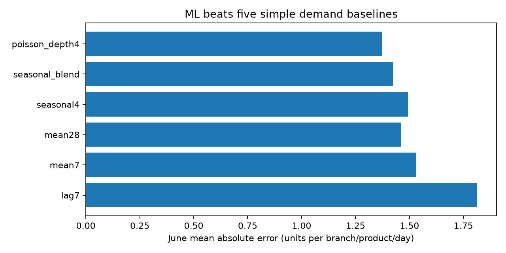
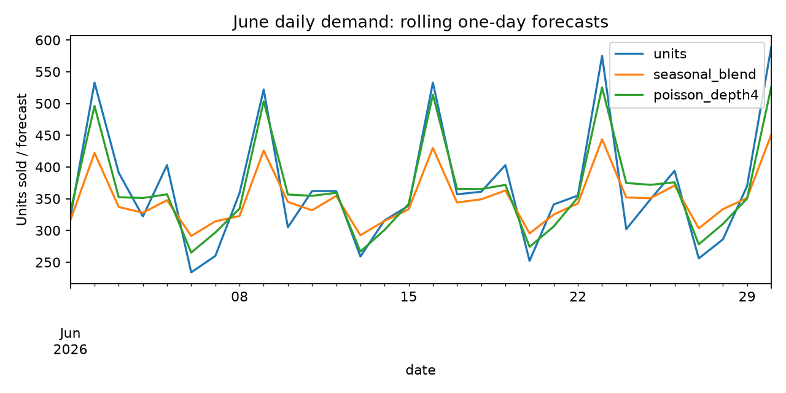
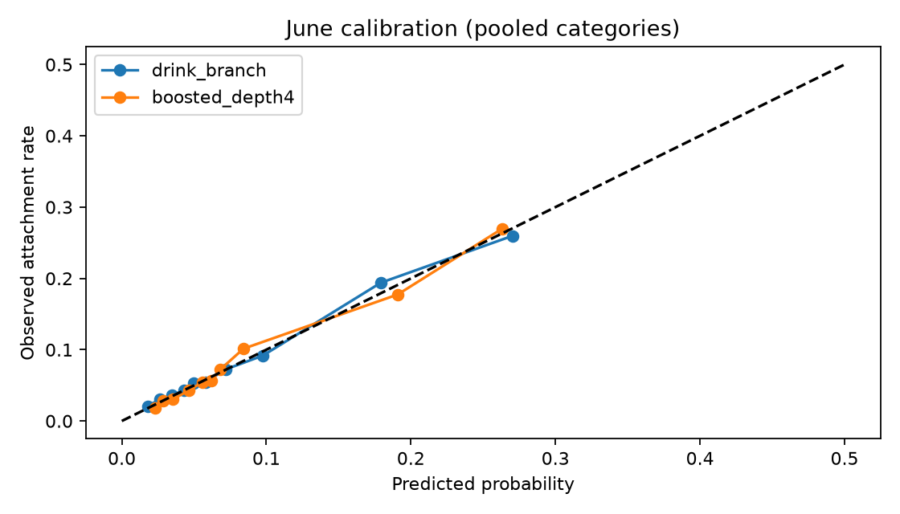

# Stories ProfitPilot: forecast first, promote only after testing

## CEO recommendation
Pilot daily food replenishment forecasts, and ask finance to verify Garden's cost allocation before funding promotions. On June's 4,050 branch/product/day observations, a Poisson gradient boosted model lowers mean absolute forecasting error **3.54%** against the strongest validation-selected simple baseline (seasonal_blend). A food-only stocking simulation shows **$290.56** more gross profit in June, but this is an assumption-dependent scenario, not measured savings. Garden's recorded unit cost is about **43% higher** than Harbour's for the same products; holding Garden's quantities fixed gives a **$15,923.47** six-month accounting gap. Verify whether that represents procurement, recipes, or allocated overhead. A separate add-on model reaches **0.745 AUC**, yet provides weak within-category discrimination; it does not justify deploying personalized promotions.

## Evidence and data quality

- 51,177 line items, 33,887 baskets, 45 products, three branches, 181 dates (2026-01-01–2026-06-30).
- Revenue: $305,925.14; recorded gross profit: $179,430.49. Gross profit excludes unrecorded rent, payroll, inventory waste and implementation costs.
- 36.52% of line items lack customer IDs. We exclude IDs entirely rather than inventing customers or using identifiers as predictive features.
- Repeated transaction IDs are multiple basket lines. Basket date, time, branch, order type and nonmissing customer values are consistent. Exact duplicate rows: 132; they are reported rather than silently deleted.
- Revenue and gross-profit arithmetic agree to rounding; maximum absolute discrepancies are $0.0050 and $0.0000. See [audit](data_audit.json).
- Branch/product unit prices and unit costs are each constant throughout the data. This limits price-response identification. The `SYN-` ID prefix alone does not establish how the data was generated.

## 1. Demand ML and replenishment decision

**Target:** next day's sold units per branch/product, including zero-sales days. Grid: 3 branches × 45 products × 181 days. The first 28 days warm up lagged features. A zero means no recorded sale, not proof of zero demand or an open/stocked store.

**Features available at decision time:** product, branch, weekday, elapsed date, yesterday's sales, last week's same-day sales, and shifted 7/28-day averages. All rolling features exclude the prediction day. No same-day revenue, profit, quantity or discount enters the forecast. Prices/costs enter the stocking scenario, not demand model features.

**Evaluation:** train after warm-up through April; choose depth 2 or 4 using May Poisson deviance; refit January–May (after warm-up), evaluate June. June forecasts are made one day at a time using preceding observed days, while model parameters remain fixed. This is not a June 1 forecast of the whole month. Seasonal controls were added as a robustness check after the initial June readout; model settings were unchanged. June is therefore an internal chronological holdout, not a pristine external benchmark. Confirm on July or a prospective pilot.

The seasonal4 control averages the preceding four matching weekdays; seasonal_blend averages seasonal4 and the shifted 28-day average. All five baselines appear below. A zero forecast is floored at .001 only for Poisson deviance, so the last-week baseline's deviance is sensitive to that floor. MAE is the primary operational comparison.

| Forecast | MAE ↓ | WAPE ↓ | Poisson deviance ↓ | Aggregate bias |
|---|---:|---:|---:|---:|
| lag7 | 1.813 | 66.68% | 5.266 | -1.22% |
| mean7 | 1.530 | 56.27% | 1.623 | -2.38% |
| mean28 | 1.463 | 53.79% | 1.468 | -5.14% |
| seasonal4 | 1.492 | 54.89% | 1.666 | -4.45% |
| seasonal_blend | 1.423 | 52.34% | 1.413 | -4.80% |
| poisson_depth4 | 1.373 | 50.49% | 1.310 | -0.75% |

MAE improvement against seasonal_blend: 0.0503 units per cell, with paired day-bootstrap 95% interval [0.0331, 0.0689] (500 resamples, seed 490). Days, rather than individual rows, are sampled to preserve within-day dependence. Serial dependence and one-month scope remain limitations. **WAPE still exceeds 50%**: low-count product/day demand is noisy, and a good aggregate forecast does not guarantee accurate individual items. Branch breakdown: [CSV](forecast_by_branch.csv).

### Translate a forecast into an order quantity

For a perishable item with no salvage value, the scenario uses `stock = PoissonQuantile((price − cost) / price, predicted_units)`. This trades off an unsold item's cost against a missed sale's gross margin. The mean forecast is learned; the Poisson predictive distribution is an assumption, not an empirically calibrated uncertainty interval.

Food only (Bakery, Breakfast, Desserts, Meals, Sandwiches), using January–May branch/product prices and costs:

| June scenario | seasonal_blend | ML |
|---|---:|---:|
| Simulated gross profit | $8,364.85 | $8,655.41 |
| Unsold units | 1,261 | 1,338 |
| Unserved recorded units | 1,476 | 1,323 |

ML stocks more and misses fewer recorded sales, but **creates more unsold units**. Do not pitch it as proven waste reduction. Scenario uplift is $290.56 before implementation costs. If pilot cost exceeds that amount for an equivalent month, this simulated advantage disappears even if all demand/cost assumptions hold. Historical sales may be censored by stockouts; actual inventory, spoilage, expiry, salvage, capacity, discount revenue, labor and substitution are missing. Discounts are deliberately excluded from scenario prices; observed June sales are treated as demand. Consequently these figures neither reconstruct historical realized profit nor estimate causal savings. The all-food spoilage assumption is intentionally visible and needs SKU-specific replacement.

## 2. Cost anomaly: a decision before a promotion

Across all 45 matched products, Garden/Harbour median recorded unit-cost ratio ranges from 1.426 to 1.439; median 1.430. Comparing identical products eliminates product mix as an explanation for this ratio. Constant costs within branch/product and the near-uniform multiplier suggest an accounting convention or systematic markup as plausible explanations, alongside real procurement/recipe differences. Transaction records cannot choose between them.

Holding Garden's actual quantities fixed and substituting Harbour's unit costs gives a six-month gap of $15,923.47. If finance confirms 10%, 25%, or 50% is removable, the corresponding **scenario** is $1,592.35, $3,980.87, or $7,961.74. No amount is claimed recoverable. Inspect [matched products](matched_product_costs.csv) and [gap by product](garden_cost_gap.csv). Reconcile supplier invoices, recipes, transfers and overhead allocation for five high-gap products first. If costs are only allocations, operational savings may be zero and a price increase would be unsupported.

## 3. Profit-aware add-ons: useful negative result

One row per beverage basket × five food categories. Label: whether that food category occurs in the completed basket. Select the alphabetically first beverage as an anchor, ignoring food labels. Inputs are anchor drink, branch, order type, hour, weekday, elapsed date and candidate category. All categories for a basket stay in the same chronological partition. Training Jan–Apr; May selects logistic versus depth 2/4 boosted models by log loss; selected model refits Jan–May; June has 4,734 beverage baskets. Customer histories, final basket size, food items, revenue, cost, discount and profit are excluded from features.

There is no item sequence: the anchor comes from the completed basket, and 19.28% of beverage baskets have multiple distinct drinks. This evaluates **masked same-basket category retrieval**, not real-time next-item behavior. A real interface must capture the initial drink before showing the recommendation and validate the resulting distribution.

| Model | Pooled ROC AUC ↑ | Average precision ↑ | Log loss ↓ |
|---|---:|---:|---:|
| category_prior | 0.722 | 0.176 | 0.2628 |
| branch_time | 0.730 | 0.187 | 0.2626 |
| drink_branch | 0.736 | 0.214 | 0.2612 |
| boosted_depth4 | 0.745 | 0.220 | 0.2596 |

The best simple baseline smooths food-category frequency by drink and branch with 30 prior observations. Pooled category-pair prevalence is 8.52%; an always-negative classifier would appear 91.48% accurate. Accuracy is misleading here. Pooled AUC also benefits from differences in category prevalence:

| Category | ML within-category AUC | June prevalence |
|---|---:|---:|
| Bakery | 0.592 | 22.39% |
| Breakfast | 0.574 | 3.36% |
| Desserts | 0.584 | 6.99% |
| Meals | 0.586 | 2.60% |
| Sandwiches | 0.585 | 7.27% |

The paired day-bootstrap interval for baseline log loss minus ML log loss is [0.000892, 0.002335]. This modest predictive gain does not establish an improvement in business decisions. Full margin-weighted retrieval policies, using January–May **branch/category** realized unit margins, are in [metrics.json](metrics.json). The proxy rewards selecting a category already present in the completed basket. It is not incremental profit, and category-average margins do not specify an actual SKU. Do not give retention discounts or claim recommendation uplift from these labels.

## Pilot, uncertainty and stop rules

1. **Finance check:** reconcile Garden costs before interpreting them as savings or using them for pricing. Record the result even if it invalidates the apparent opportunity.
2. **Shadow mode:** run daily forecasts for two weeks without changing orders. Record available inventory, opening hours, sell-outs, discarded units and unit costs. Check error and bias by branch/product and record deviations from model quantities.
3. **Controlled replenishment test:** randomize comparable branch/product groups to current process or forecast-assisted ordering, stratified by branch/category and historical volume. Keep assignments stable during the test, exclude or cluster substitutes, log stock transfers and pre-register analysis. Start with a small perishable menu with known shelf life. Primary endpoint: gross profit net of waste and incremental handling cost per assigned product/day; secondary: stockout frequency and waste. Use cluster-aware uncertainty; three branches alone are not enough independent clusters for confident branch-only inference. Stop if agreed stockout/waste service limits are breached; set limits with operations before launch.
4. **Scale gate:** widen only if the lower confidence bound for net benefit is above zero and service limits hold. The dataset cannot determine required sample size: collect pilot variance, serial correlation and a minimum worthwhile effect, then power the test. No invented significance threshold in dollars or guaranteed duration.
5. **Optional add-on experiment later:** randomly assign beverage baskets to no prompt, a simple branch/drink margin rule, or the ML margin rule. Same menu availability and no automatic discount. Log exposures, acceptance and total basket gross profit, including cannibalization and prompt cost. Customer-level stable assignment if repeat customers can be identified; otherwise record repeat-customer contamination as a limitation.

## Choices rejected

- Predicting line gross profit from price/cost/quantity: arithmetic leakage, not a useful ML contribution.
- Random row split: shares basket lines and time regimes across train/test.
- Discount optimization or uplift training: recommendation exposures, randomized promotions, stockouts and price variation are absent; 15% discounts occur only at Harbour, so treatment and branch are confounded. Recorded co-movement cannot identify price elasticity.
- Customer churn/CLV as the main pitch: 36.5% of lines lack customer ID and observation covers only six months.
- Vision or a chatbot-first website: no drink-image labels; neither improves evidence from this dataset.
- Claiming the largest AUC as the winner: policy utility and within-category discrimination tell a less flattering but more useful story.

## Inspection and reproducibility

Run commands in the root [full report](../FULL_REPORT.md). Machine-readable evidence: [forecast metrics](forecast_metrics.json), [classification metrics](metrics.json), [cost audit](cost_audit.json), [data audit](data_audit.json). Model hyperparameters and preprocessing live in `src/`. Figures and aggregate CSVs are generated from the source CSV; raw data, row-level predictions and serialized models are excluded from publication by default. Training has fixed random seed 490. The source-file SHA-256 is recorded to identify the input without publishing it. Team names must be filled in before submission. No public repository has been created or submission sent.

## Additional robustness and policy evidence

The ML margin policy's matched-margin proxy is $0.596 per held-out beverage basket versus $0.601 for the simpler drink/branch margin rule. This is why the recommendation model's AUC improvement is not the main business claim. Neither proxy measures incremental profit.

Stocking sensitivity varies realized selling price (100% or 90% of the training list price) and salvage value (0%, 25%, 50% of cost), recomputing the same newsvendor rule for both frozen forecasts. This explores assumptions rather than selecting a best policy from June:

| Selling price factor | Salvage / cost | ML minus baseline simulated gross profit |
|---:|---:|---:|
| 100% | 0% | $290.56 |
| 100% | 25% | $283.27 |
| 100% | 50% | $297.11 |
| 90% | 0% | $259.09 |
| 90% | 25% | $246.39 |
| 90% | 50% | $249.56 |

These scenarios hold recorded demand fixed even when price changes; they are accounting sensitivities, not demand-response predictions. Positive values do not remove the need to measure censored demand, waste and implementation cost in a pilot. Full figures: [CSV](stocking_sensitivity.csv).
