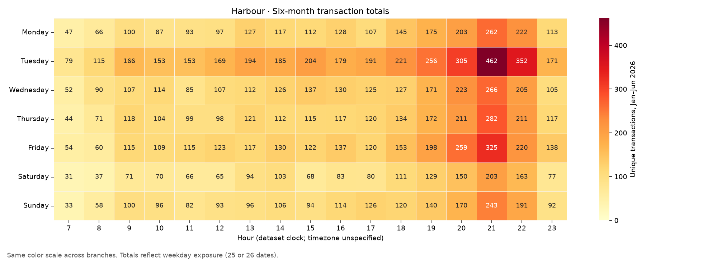
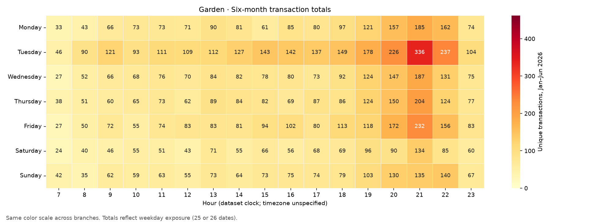
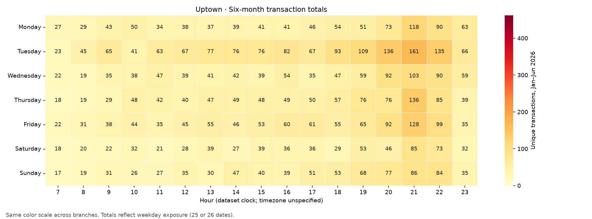

# Step 4 — Transaction activity heatmaps

No model was trained. Counts use one record per unique basket. The supplied code needs `txn` rather than `transaction_id` in the supplied notebook; time parsing explicitly uses `%H:%M:%S`.

Three total heatmaps reproduce the requested six-month view. Three additional average heatmaps divide each weekday/hour by its number of calendar dates (25 or 26). All branches use a common color scale within each chart type. This supports cross-branch comparison without giving Uptown its own misleading bright-red maximum.

All three branches have transactions on all 181 dates. That does not establish every opening hour. Observed sales hours span 07:00–23:59; zeros within that range are included in the calendar-average denominator and may represent closure, stockouts or genuine zero sales. No opening-hour normalization can be claimed without a verified schedule.

## Harbour

Lowest pooled hours: 07:00 (1.88 transactions/date), 08:00 (2.75 transactions/date), 11:00 (3.83 transactions/date). Peak hour: 21:00. Weakest average weekday: Saturday. Tuesday averages 136.73 transactions/date, or 1.66× the equally weighted mean of other weekdays. These are descriptive pooled results, not proof each date has the same pattern.

[Calendar-date average heatmap](../../figures/activity/harbour_daily_average.png)

## Garden

Lowest pooled hours: 07:00 (1.31 transactions/date), 08:00 (1.99 transactions/date), 10:00 (2.59 transactions/date). Peak hour: 21:00. Weakest average weekday: Saturday. Tuesday averages 94.65 transactions/date, or 1.69× the equally weighted mean of other weekdays. These are descriptive pooled results, not proof each date has the same pattern.

[Calendar-date average heatmap](../../figures/activity/garden_daily_average.png)

## Uptown

Lowest pooled hours: 07:00 (0.81 transactions/date), 08:00 (1.01 transactions/date), 09:00 (1.45 transactions/date). Peak hour: 21:00. Weakest average weekday: Saturday. Tuesday averages 53.15 transactions/date, or 1.64× the equally weighted mean of other weekdays. These are descriptive pooled results, not proof each date has the same pattern.

[Calendar-date average heatmap](../../figures/activity/uptown_daily_average.png)

## Interpretation before choosing a forecasting target

Tuesday outperformance appears at all branches; the earlier within-week analysis addresses its persistence more directly. These heatmaps alone do not test statistically significant branch differences or identify their causes. Compare normalized shapes and use date/week as the uncertainty unit if testing heterogeneity later.

The quietest slots are investigation candidates, not automatic promotion opportunities. A low-sales hour may have no reachable audience, a closed shop or insufficient stock; a busy hour may still have unmet demand. Obtain actual operating schedules, footfall, conversion, inventory/stockout and staffing data, then quantify incremental contribution and intervention cost. Do not rank profit opportunity by low transaction count alone.

Outputs: `branch_weekday_hour.csv` (totals and denominators), `daily_branch_hour_counts.csv` (date-level panel for persistence checks), `summary.json`, and six figures. Reproduce with `python3 src/hourly_activity.py --data /path/to/stories_transactions.csv`. The original source CSV and supplied notebook remain unchanged.
