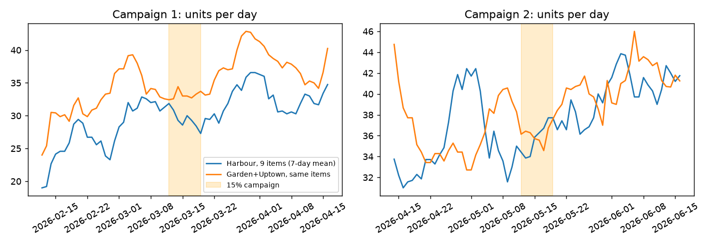
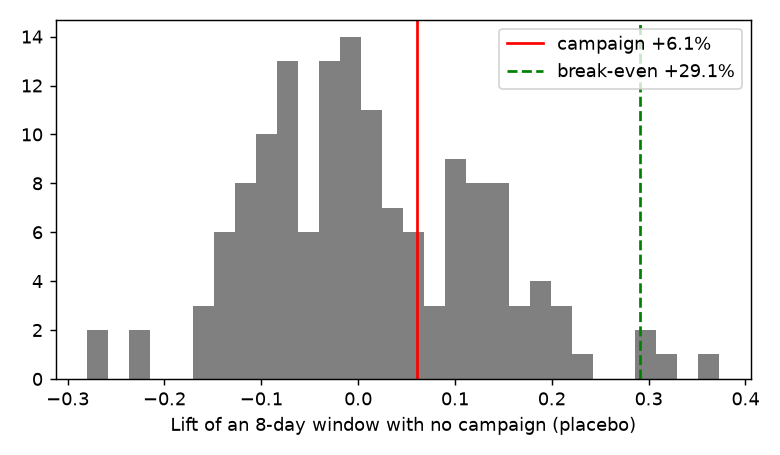

# Discount audit: did the promotions pay for themselves?

Generated by `src/promo_audit.py`. Every number below is recomputed from the CSV.

## 1. Harbour's 15% campaign: a natural experiment

- 15% discount lines: 504, all at Harbour, all on 16 days (2026-03-12 to 2026-03-19 and 2026-05-12 to 2026-05-19), on 9 items: Brownie, Cheesecake Slice, Coffee Frappe, Cold Brew, Frozen Yoghurt Cup, Iced Americano, Iced Latte, Iced Mocha, Tiramisu Cup.
- On campaign days 100% of eligible Harbour lines got 15% off, so it was a shelf price cut, not a coupon. Every eligible customer received it.
- Discount given away: **$472** over 16 days.
- Control: the same nine items at Garden and Uptown, which never had the offer. Baseline: non-campaign days within 28 days of each campaign.

| Estimate | Lift in units of the 9 items | 95% placebo range | Placebo p-value |
|---|---|---|---|
| Harbour vs controls (DiD) | +6.1% | -9.0% to +25.1% | 0.46 |
| Also netting Harbour's other items (DDD) | +6.1% | -8.0% to +22.8% | 0.40 |

Per campaign (DiD): 2026-03-12 to 2026-03-19: +10.1%; 2026-05-12 to 2026-05-19: +3.1%.

- **Break-even lift:** +29.1% more units (gross profit per unit fell from $3.836 to $2.970; the item margin of 66% gives the same +29% from the formula m/(m-0.15)-1).
- Noise in any 8-day window is about +/-17%, so a small real lift could hide. But the top of the 95% range (+25%) is still below break-even (+29%). Only 1.1% of placebo draws are as far from the estimate as break-even is. **The campaign lost gross profit with about 99% confidence.**
- Net gross profit effect at the point estimate: **$-350** over 16 days.
- Measured: the units, the discount dollars and the placebo range. Not measured: whether the offer brought in new customers who return later (customer IDs cannot answer this, see section 3).

## 2. The 10% discount behaves like a random line flag, not a strategy

- 2861 lines (5.6%) at all branches, all 45 products, every month (monthly share 5.2% to 5.9%) and 181 of 181 days.
- 1950 of 3247 discounted baskets mix discounted and full-price lines, so it is applied per line, not per customer or per basket.
- If each line were flagged independently with probability 0.056, 8.3% of baskets would contain one. Observed: 8.2%. That match is why discounted baskets look bigger (more lines, more chances), which is not evidence that discounts grow baskets.
- Cost: **$1,707** in six months (Garden $557, Harbour $828, Uptown $322).
- At Garden's recorded cost, a 10% discount leaves 7 items under 30% margin: Sparkling Water 22%, Turkey & Cheese Sandwich 22%, Chicken Pesto Sandwich 24%, Brownie 27%, Cheesecake Slice 28%, Chicken Salad Bowl 28%, Avocado Toast 30%.

## 3. Customer IDs carry no loyalty signal

- 3494 IDs, numbered 1 to 3500, mean 6.16 visits each. Variance/mean of visits per customer = 0.99 (1.0 means every ID is equally likely on every visit; real loyalty data is heavily skewed).
- 94% of IDs appear at more than one branch.
- So repeat visit, churn and loyalty analyses would only describe random labels. We make no customer-level claim and recommend Stories check this on its own CRM before using these IDs.

## 4. Uptown: its gap is traffic, its pricing is also a formula

- Uptown cost = round(Harbour cost x 0.96, 2) on 45/45 products; price = Harbour price x 0.914 on 37/45 exactly and within 1 cent on 45/45.
- So Uptown is 8.6% cheaper for a 4% lower cost. Unit margin 64.3% vs Harbour 66.0%.
- Gross profit per transaction: Uptown $5.46, Harbour $5.98, Garden $4.19. Transactions per day: Uptown 35.3, Harbour 90.2, Garden 61.7.
- Uptown earns $347.36/day less than Harbour; $299.91 of that (86%) is fewer transactions at Uptown's own profit per transaction. Uptown's problem is footfall, not price or cost. Garden is the opposite: its profit per transaction is 30% below Harbour's.
- Decision: Garden's lever is cost and price (README action 1 and 2). Uptown's lever is traffic, which nothing in this file can test, so we do not invent an Uptown action.

## 5. Saturday is the quietest day at every branch

| Branch | Mon | Tue | Wed | Thu | Fri | Sat | Sun |
|---|---|---|---|---|---|---|---|
| Garden | 0.98 | 1.56 | 0.99 | 0.96 | 1.06 | 0.70 | 0.84 |
| Harbour | 0.95 | 1.53 | 1.02 | 0.96 | 1.07 | 0.69 | 0.84 |
| Uptown | 0.96 | 1.52 | 0.98 | 1.00 | 1.06 | 0.70 | 0.84 |

- Index relative to Mon/Wed/Thu/Fri. Saturday is 0.70, the same at all three branches to two decimals, like Tuesday. That uniformity is another sign of a shared weekday setting. If Stories' tills confirm it, Saturday is the day to trim staff and fresh bakery prep, the mirror of the Tuesday action.

## What we rejected

- A plain before/after at Harbour: it would credit the campaign with Harbour's growth from January to June. The control branches remove that.
- Reading elasticity from the 10% flag: it is not tied to time, customer or item, so there is no variation to learn from.

## What would change the conclusion

- If the offer targeted new customers through an app, the value is in later visits, which this file cannot track. Stories' CRM can.
- If the March and May windows were chosen because sales were expected to dip, the comparison would understate the lift. We assume the dates were not chosen that way.
- A 15% cut on margin-66% items needs about +29% volume. Any future discount should be judged against m/(m-d)-1 before launch, and run with a control branch as here.
