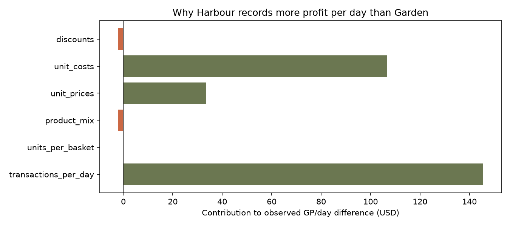
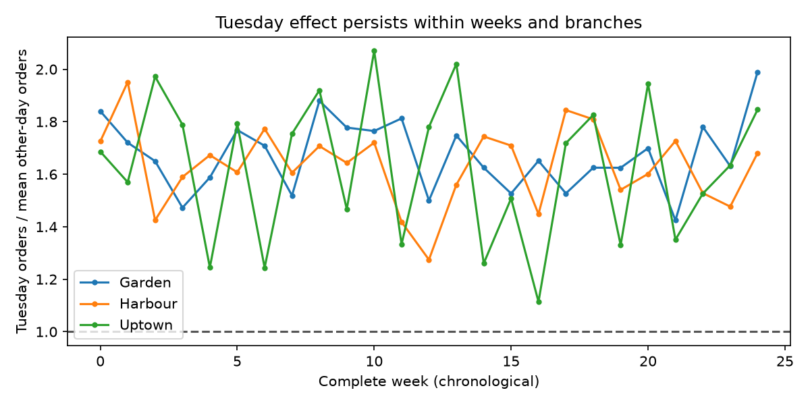
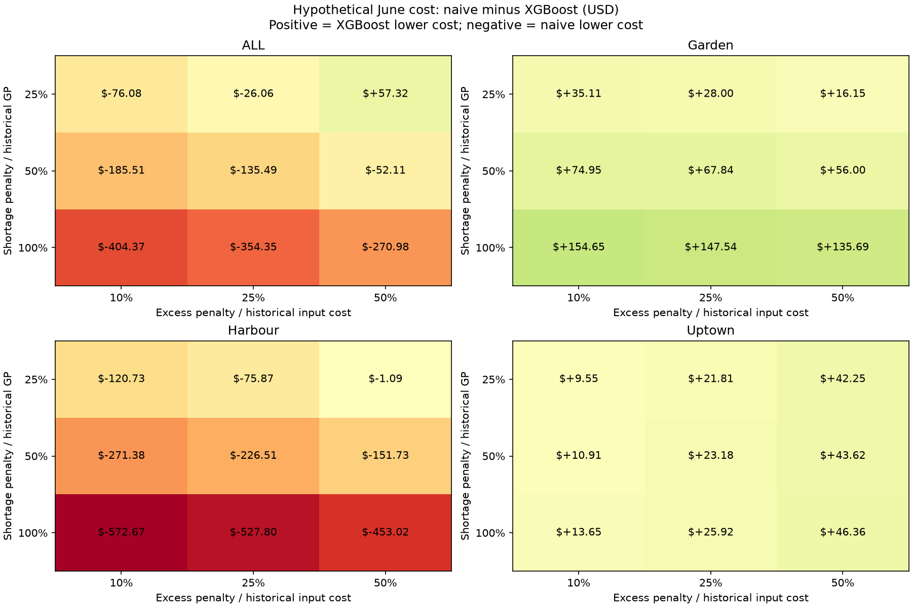
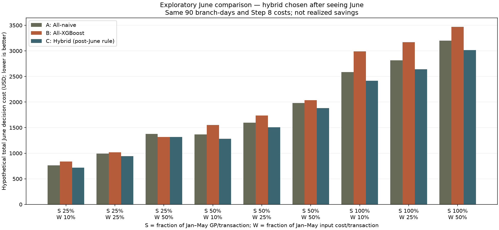

# Root-cause investigation: explain the dollars before designing offers

## Business purpose and new decision analysis

Our analysis goes beyond traditional exploratory data analysis and machine learning predictions by focusing on how Stories Coffee can make more profitable business decisions. Through a detailed investigation of transaction patterns, product costs, pricing strategies, and discount behavior, we identified specific opportunities for improving profitability and quantified their associated financial exposure. Rather than assuming that higher sales or more accurate predictions automatically translate into greater profits, we evaluated the financial implications of different business decisions and compared our approaches against simple baselines. We also developed a decision-support framework to assess how Stories Coffee could adapt its pricing, product selection, and operational strategies under both normal conditions and potential disruptions, including periods of conflict that may affect customer demand and operating costs. Although the estimated financial benefits require further validation through controlled experiments, our findings provide actionable recommendations that management can test before implementing changes. Ultimately, our objective is not simply to predict business performance, but to help Stories Coffee identify opportunities to increase gross profit, minimize avoidable losses, and strengthen its financial resilience during uncertain conditions.

These aims do not establish realized savings or causal uplift. The [business decision framework](../BUSINESS_DECISION_FRAMEWORK.md) explains the role of the [location research](LOCATION_RESEARCH_AND_SAFE_SOLUTION.md), missing branch mapping and [item-level discount/profit scenarios](../item_discount_scenarios/REPORT.md). The latter uses a full-list-price forecast reference and assumed quantity lifts; no actual profit floor or location-based demand response is guaranteed.

## What changes in the project

Lead with a reproducible investigation of recorded profit and transaction differences. Keep forecasting as supporting validation and operational infrastructure. The camera, loyalty concepts and bundle planner are prototypes; they do not establish a root cause or a measured financial benefit. We should not use technical complexity as evidence of originality. The user-supplied `01_eda.ipynb` is a useful starting analysis, not a set of instructions or proof that its assumptions are true. It remains untouched.

## 1. Why does Harbour record more gross profit than Garden?

Observed GP per calendar day: Harbour **$540.08**, Garden **$258.53**. Gap: **$281.54/day**. An exact accounting decomposition separates six factors in the identity:

`GP/day = transactions/day × units/transaction × Σ product unit share × [price × (1 − effective discount) − unit cost]`.

All 720 possible orders of changing the six factors from Garden to Harbour are averaged (Shapley decomposition). This allocates interaction terms symmetrically rather than choosing a convenient order. Rounding is included in the effective discount so the identity reproduces the recorded money exactly.

| Accounting factor | Contribution to observed GP/day gap | Share of net gap |
|---|---:|---:|
| transactions_per_day | $145.58 | 51.7% |
| units_per_basket | $-0.01 | -0.0% |
| product_mix | $-2.22 | -0.8% |
| unit_prices | $33.59 | 11.9% |
| unit_costs | $106.80 | 37.9% |
| discounts | $-2.19 | -0.8% |

Negative entries offset the positive contributions; positive shares can sum above 100%. These are contributions to an **observed accounting gap**, not causal effects or savings. In particular, the transaction-count contribution does not show whether Harbour has better location, marketing, footfall or conversion. We need storefront visitor counts and campaign exposure to distinguish them.



### Rule out the obvious alternative: product mix

For all 45 matched products, Garden's price/Harbour price is 0.953 at the median, with a narrow 0.951–0.953 range. Its cost ratio is 1.430, range 1.426–1.439. The price and cost differences exist **within the same products**, not just because Garden sells different items. Matching products and the small Shapley mix contribution weaken product mix as an explanation for the profit gap.

Every branch/product price and unit cost is constant over the observation window. A near-uniform branch cost multiplier across coffee, food and packaged drinks is compatible with a standard-cost allocation rule as well as a real branch-wide procurement or recipe difference. It cannot identify which. The smaller Uptown branch has lower recorded unit costs than Harbour, so a simple 'small branch ⇒ higher cost' narrative does not fit the ordering; this does not rule out other scale effects.

### Investigate the mechanism, then size a decision

| Competing explanation | What this file tests | Evidence needed to distinguish it | Action if confirmed |
|---|---|---|---|
| Different overhead allocation | Near-uniform multiplier is compatible; not proof | Finance cost formula, chart of accounts and allocations for identical SKUs | Normalize reporting; do not call accounting reclassification cash savings |
| Supplier/transfer-price difference | Same-product gap exists; invoices absent | Landed-cost invoices and transfer prices for matched products on matched dates | Negotiate or standardize sourcing only after measuring total landed cost |
| Recipe/portion/waste difference | Standard recorded costs are fixed; actual usage absent | Recipe grams, yields, inventory movements, waste and sampled portions | Change the operational process responsible; include quality/service tradeoffs |
| Local pricing strategy | Garden price is consistently lower; elasticity unobserved | Local demand context and a controlled pricing test | Adjust only if net GP and customer response justify it |

At **Garden's own observed quantities**, replacing only recorded costs with Harbour's gives a six-month accounting sensitivity of **$15,923.47**. This differs from the Shapley cost contribution because the latter averages interactions with both branches' volumes and other factors. Do not add the two figures.

If 10%, 25% or 50% of that fixed-volume gap is genuinely removable cash cost, the corresponding six-month scenarios are **$1,592.35**, **$3,980.87** or **$7,961.74**, before implementation costs. If the whole gap is only allocation, avoidable cost may be zero. No annual extrapolation is used as the headline.

Aligning Garden prices with Harbour at unchanged volumes and discount percentages adds **$4,985.11** in six-month revenue and GP. Under a **uniform volume-loss, unchanged-mix and unchanged-unit-cost assumption**, a loss of about **9.6%** of units would erase that GP improvement. This is a break-even boundary, not an elasticity estimate or a recommendation to raise prices now.

## 2. Why does Tuesday outperform?

We can identify the measured mechanism—**more transactions rather than higher spending per basket**—and test competing explanations. The ultimate behavioral reason remains unidentified.

- Tuesday is the highest network transaction day in **25 of 25 complete weeks**. Comparing each Tuesday to the mean of the other days in the same week gives ratios from **1.44 to 1.81**, median **1.61**. This avoids treating late-period growth as a weekday effect.
- Tuesday mean basket revenue is **$9.0280** versus **$9.0277** on other days. Average basket sizes are **1.592** versus **1.597** units.
- Tuesday category unit shares have total-variation distance **1.15%** from other days. This is descriptive closeness, not a formal equivalence test or evidence that the same people visit.
- Across all 17 recorded hours, Tuesday/other-day average transaction ratios remain above 1, ranging **1.43–1.89**. The pattern is broader than one evening slot. Per-branch/week results are in [CSV](tuesday_by_branch_week.csv).



### Step 5 — Tuesday daily distributions (weekday-only comparator)

The requested code was run on unique transaction counts for each branch/date. All three branches have records on all 181 dates: **543 branch-days** in total. Tuesday has **78 branch-days**; the comparator has **309**. Here **other weekdays means Monday, Wednesday, Thursday and Friday only**. Saturday and Sunday appear in the boxplot but are excluded from the four printed comparison values. This differs from earlier comparisons against all six non-Tuesday days.

| Printed statistic | Transactions per branch-day |
|---|---:|
| Tuesday mean | 94.846154 |
| Other weekdays mean | 61.796117 |
| Tuesday median | 92.500000 |
| Other weekdays median | 59.000000 |


Both pooled Tuesday mean and median exceed the weekday-only comparator. The mean ratio is **1.535×**; the median ratio is **1.568×**. A higher median supports a shift in typical observed activity rather than relying only on the mean. It does not alone prove that exceptional dates play no role: branch scales and long-run growth are mixed together in the pooled boxes.

| Branch | Tuesday mean | Other weekday mean | Tuesday median | Other weekday median |
|---|---:|---:|---:|---:|
| Garden | 94.65 | 60.82 | 95.00 | 60.00 |
| Harbour | 136.73 | 89.55 | 136.00 | 88.00 |
| Uptown | 53.15 | 35.02 | 49.50 | 35.00 |

[Branch-stratified boxplots](../../figures/activity/tuesday_weekday_boxplot_by_branch.png) use the same vertical scale and show that the mean and median direction is shared by each branch. No formal significance claim is made. The earlier complete-week analysis is the stronger persistence check: Tuesday was the busiest network day in all 25 complete weeks, which is evidence beyond these pooled distributions. Neither check identifies customer motivation, payroll timing, promotion effects or achievable extra profit.

Reproduce: `python3 src/tuesday_distribution.py --data /path/to/stories_transactions.csv`. [Four values and branch diagnostics](../activity/step5_tuesday_distribution.json); [daily counts](../activity/step5_daily_transactions.csv). **No model was trained in Step 5.**


### Is 'people got paid' supported?

We tested **illustrative** calendar proxies: days 1–3, 14–16 and 25–month end. These are not actual local salary dates: the dataset supplies no country, payroll schedule or verified calendar. We fit log daily transactions with branch×week fixed effects, weekday indicators and those calendar proxies, using 525 branch-day observations in 25 complete weeks. Standard errors cluster by week to account for common variation across branches and days. Intervals are exploratory; model choice and multiple hypotheses were not pre-registered, only six months exist, and cross-week dependence may remain.

The adjusted Tuesday ratio versus the **geometric mean** of other weekday counts is **1.659**, 95% interval **1.602–1.718**. This is a conditional association in log counts, not an estimate of what changing a date would cause.

| Hypothetical calendar window | Adjusted count ratio | Exploratory 95% interval |
|---|---:|---:|
| first3 | 1.037 | 0.987–1.090 |
| mid3 | 0.995 | 0.945–1.048 |
| end7 | 0.988 | 0.921–1.061 |

None of these monthly-date proxy intervals excludes 1. The calendar controls do not explain away the Tuesday association. **This does not disprove payday effects**: a weekly payday that always lands on Tuesday is observationally confounded with weekday, and different salary schedules were not observed. Do not invent a country, payday or local explanation to complete the story.

### Is the recorded 15% campaign the explanation?

Removing **all 16 dates** on which any branch has a 15% line discount—including observations at other branches on those dates—still gives a Tuesday ratio of **1.648**, interval **1.588–1.710**. That weakens the explanation that these recorded campaign dates alone create the recurring Tuesday pattern. It does not identify discount effectiveness or exclude unrecorded recurring offers.

| Behavioral hypothesis | Current status | Discriminating next evidence |
|---|---|---|
| Month-end/midmonth salary timing | Tested proxies do not explain the recurring Tuesday effect | Actual local pay calendar; customer/source-of-visit evidence; more months |
| Weekly payday, recurring event or hidden Tuesday promotion | Still plausible and indistinguishable here | Promotion/event calendar including off-POS channels and associated campaign costs |
| Bigger baskets or category shift | Not the main arithmetic mechanism in this data | Controlled customer/occasion study if a behavioral claim is needed |
| A particular branch or isolated hour | Pattern is broad across branches/hours; inspect CSV heterogeneity | Local footfall and operating schedules by site |
| Construction or anonymization artifact | Possible; `SYN-` prefix or regular patterns alone do not prove it | Data provenance, replacement-ID procedure and whether a date multiplier was applied |

The next useful step is to reconcile the Tuesday calendar with Stories' promotion and operations records. If a hidden promotion exists, assess **total contribution net of campaign cost**, rather than copy the pattern into a new discount. If the pattern reflects provenance transformations, do not base a real staffing or pricing intervention on it. Without labor, inventory and lost-sale records, we cannot price the value of extra staffing or preparation.

## 3. What is driving growth—and what is not?

Network revenue per calendar day rises from **$1,327.28 in January** to **$2,088.07 in June**. A three-factor Shapley identity decomposes the change into:

- Transactions/day: **+$757.45/day**.
- Units/basket: **+$3.44/day**.
- Realized revenue/unit: **$-0.10/day**.

Approximately 99.6% of the accounting increase comes from transaction counts. That does not establish customer acquisition: one person can make multiple purchases and footfall is unobserved.

A useful countercheck to the supplied notebook's growth narrative: the **January first-observed customer cohort** contributes 2,871 transactions in January versus 2,469 in June, and revenue **$26,087.54** versus **$22,239.78**. Overall identified transactions nevertheless rise from 2,871 to 4,412. Later first-observed cohorts contribute to that composition change. This neither proves acquisition nor a retention failure: first-observed dates are censored by the file start, January cohort selection guarantees January activity, and customer-ID capture/provenance is uncertain. See [cohort CSV](observed_first_cohort_growth.csv).

## 4. Resolve notebook assumptions rather than silently inheriting them

The supplied notebook drops 132 exact duplicate rows, interpreting them as POS/export duplication. Repeated identical lines can also be genuine two-item entries. Both representations must be checked until POS logs resolve the issue. Excluding them changes revenue by **$741.43** and the Garden cost sensitivity from **$15,923.47** to **$15,887.50**. The main economic issue is robust, but the duplicate mechanism is not established.

Other distinctions matter: recorded sales hours do not prove opening hours; missing customer ID does not prove nonmembership; first-observed customers do not prove new customers; a branch-choice simulation matching the observed distribution does not prove IDs are randomized. Customer-level conclusions require corroboration rather than automatic rejection or acceptance.

## Decision priority and evidence request

1. **Finance/operations cost reconciliation first.** Compare the five Garden products with the largest dollar cost gaps against Harbour invoices, standard-cost formulas, recipes and waste. Determine which components are avoidable cash cost. Quantified opportunity is a bounded scenario, not a promise.
2. **Investigate the common Tuesday mechanism.** Join a verified promotion/event calendar and data-provenance description to the date/branch panel. If neither explains it, collect customer occasion and footfall evidence. Record disconfirming evidence as well as a preferred story.
3. **Validate the growth mechanism.** Join footfall/conversion and stable customer identity before choosing acquisition, retention or basket expansion as the intervention.
4. **Use the forecasts and offer planner downstream.** They can support a tested intervention once the business mechanism is understood. No additional cashback, camera or bundle feature is needed to establish these findings.

### Step 6 — Daily branch transaction forecasting dataset

**No model trained.** Created [02_demand_forecasting.ipynb](../../notebooks/02_demand_forecasting.ipynb) and local [daily_demand_features.csv](../../daily_demand_features.csv). The panel has **543 observations** (3 branches × 181 dates, Jan 1–Jun 30, 2026), **0 missing branch-days**, and **0 missing target values**. Target is unique observed transactions per branch/date, not unconstrained demand.

| Requested feature | Missing values |
|---|---:|
| Branch | 0 |
| DayOfWeek | 0 |
| Month | 0 |
| DayOfMonth | 0 |
| Weekend | 0 |
| Lag1 | 3 |
| Lag7 | 21 |
| RollingMean7 | 21 |

Initial history blanks are expected: one lag-1 value per branch and seven lag-7/rolling values per branch. All rows remain in the CSV; 522 have complete requested features and target. No filling or dropping is performed. DayOfWeek is a name, Weekend is Saturday/Sunday = 1, and MissingBranchDay is an audit flag rather than a predictor. Date and all other exported calendar/audit columns have no missing values in this file.

All dates are explicitly reindexed within branch. Missing branch-days, if present, remain unknown. Lag1 and Lag7 refer to one/seven calendar days earlier; RollingMean7 uses a shift of one day and requires all seven preceding calendar dates. A missing observation propagates rather than silently becoming zero or an average over fewer days.

The forecast origin is **after the previous day closes**. These features are not a valid drop-in setup for forecasts issued a full week ahead. Calendar features are known in advance; observed branch-day presence does not prove full-day opening or absence of stockouts.

First 15 rows (sorted branch/date):

```text
Branch       Date DayOfWeek  Month  DayOfMonth  Weekend  Lag1  Lag7  RollingMean7  Transactions  MissingBranchDay
Garden 2026-01-01  Thursday      1           1        0  <NA>  <NA>           NaN            48             False
Garden 2026-01-02    Friday      1           2        0    48  <NA>           NaN            48             False
Garden 2026-01-03  Saturday      1           3        1    48  <NA>           NaN            36             False
Garden 2026-01-04    Sunday      1           4        1    36  <NA>           NaN            47             False
Garden 2026-01-05    Monday      1           5        0    47  <NA>           NaN            32             False
Garden 2026-01-06   Tuesday      1           6        0    32  <NA>           NaN            73             False
Garden 2026-01-07 Wednesday      1           7        0    73  <NA>           NaN            40             False
Garden 2026-01-08  Thursday      1           8        0    40    48     46.285714            37             False
Garden 2026-01-09    Friday      1           9        0    37    48     44.714286            50             False
Garden 2026-01-10  Saturday      1          10        1    50    36     45.000000            43             False
Garden 2026-01-11    Sunday      1          11        1    43    47     46.000000            36             False
Garden 2026-01-12    Monday      1          12        0    36    32     44.428571            48             False
Garden 2026-01-13   Tuesday      1          13        0    48    73     46.714286            80             False
Garden 2026-01-14 Wednesday      1          14        0    80    40     47.714286            62             False
Garden 2026-01-15  Thursday      1          15        0    62    37     50.857143            47             False
```

Temporal checks executed in the notebook: deleting June 1 and later records does not change June 1 or earlier predictors; deleting Garden January 20 leaves its target unknown and correctly propagates missing lags/rolling history; unique keys and the 33,887 source transactions reconcile; CSV missingness survives serialization. These checks modify copies only. The original transaction file is unchanged.

Reproduce: `python3 src/prepare_daily_demand.py --data /path/to/stories_transactions.csv`. To regenerate the executed notebook: `STORIES_DATA=/path/to/stories_transactions.csv python3 src/build_demand_notebook.py`. [Machine-readable audit](../demand_forecasting/feature_summary.json); [missing-date list](../demand_forecasting/missing_branch_days.csv). No baseline fitting, imputation, model training or model selection took place in Step 6.


### Step 7 — Daily transaction forecasting: first model comparison

Target: next-day unique recorded transactions per branch, using the eight Step 6 features. **Train: Jan 8–Apr 30 (339 rows); validation: May 1–31 (93 rows); test: June 1–30 (90 rows).** Each date stays in one partition. Predictions for May/June use observed prior-day histories as they become available, with no parameter updates during either evaluation month. This is not a June 1 forecast of the whole month.

The search was fixed in advance: **four Random Forest and four XGBoost settings**, seed 490, selected by pooled May MAE. Branch and weekday are one-hot encoded inside training-only pipelines. Numeric features pass through without scaling or imputation. After locking configurations and the overall winner on May, selected ML pipelines and preprocessing refit Jan 8–May 31, then score June. The original transaction CSV and feature CSV are unmodified.

| Model | May MAE | May RMSE | May WAPE | June MAE | June RMSE | June WAPE |
|---|---:|---:|---:|---:|---:|---:|
| Seasonal naive | 8.9355 | 12.3319 | 12.91% | 9.6000 | 11.6113 | 12.51% |
| Random Forest | 9.1987 | 13.1514 | 13.29% | 10.0521 | 13.4934 | 13.10% |
| XGBoost | 8.2523 | 12.4338 | 11.92% | 9.1015 | 12.2786 | 11.86% |

**Selected on validation: XGBoost.** Lowest June MAE (descriptive, not used to switch the choice): XGBoost. The validation-selected method has **5.19% lower June MAE** than seasonal naive. MAE and RMSE are transactions per branch-day. WAPE is total absolute error divided by total transactions, not classification accuracy.


#### Branch-level results

**Validation**

| Branch | Model | MAE | RMSE | WAPE |
|---|---|---:|---:|---:|
| Harbour | Seasonal naive | 12.2581 | 16.8753 | 12.22% |
| Harbour | Random Forest | 12.2900 | 17.6548 | 12.25% |
| Harbour | XGBoost | 12.1586 | 17.8270 | 12.12% |
| Garden | Seasonal naive | 7.2903 | 9.1933 | 10.62% |
| Garden | Random Forest | 9.1824 | 11.6453 | 13.38% |
| Garden | XGBoost | 6.5507 | 8.7375 | 9.54% |
| Uptown | Seasonal naive | 7.2581 | 9.3239 | 18.73% |
| Uptown | Random Forest | 6.1237 | 8.4600 | 15.81% |
| Uptown | XGBoost | 6.0474 | 8.3458 | 15.61% |

**Test**

| Branch | Model | MAE | RMSE | WAPE |
|---|---|---:|---:|---:|
| Harbour | Seasonal naive | 11.2333 | 13.8263 | 9.95% |
| Harbour | Random Forest | 13.1179 | 18.0624 | 11.62% |
| Harbour | XGBoost | 11.4805 | 16.1115 | 10.17% |
| Garden | Seasonal naive | 10.2333 | 11.8251 | 13.64% |
| Garden | Random Forest | 10.1715 | 12.1595 | 13.56% |
| Garden | XGBoost | 9.3153 | 11.2545 | 12.41% |
| Uptown | Seasonal naive | 7.3333 | 8.5713 | 17.34% |
| Uptown | Random Forest | 6.8668 | 8.4915 | 16.23% |
| Uptown | XGBoost | 6.5088 | 8.1271 | 15.39% |

**Mixed evidence:** June RMSE is lowest for Seasonal naive, so the MAE winner is not the winner on large-error penalties. June per-branch MAE winners are {'Harbour': 'Seasonal naive', 'Garden': 'XGBoost', 'Uptown': 'XGBoost'}. These are descriptive June comparisons; no branch-specific hybrid is selected from June. The paired-date interval includes zero, so this month does not establish a reliable improvement. Random Forest is retained in the report even if it loses to the baseline.

#### Interpretation and limits

The selected model misses by 9.10 transactions per branch-day on average in June, compared with 9.60 for copying the same weekday last week. Better forecasts can guide staffing/preparation planning, but do not establish extra sales, dollars saved, optimum inventory or treatment effects. Transaction counts do not specify products or preparation quantities; product mix and cost/capacity information are needed before converting this target into stocking decisions.

Paired-date bootstrap 95% interval for baseline MAE minus the validation-selected model's MAE: **-0.7294–1.8134** transactions/day (1,000 resamples, three branches kept together within each date). Only 30 June dates exist; serial dependence and explored model families limit generalization. This uncertainty summary is not used for selection.

June was already inspected during earlier EDA and separate model tasks. This run excludes June from tuning, but cannot retroactively make it an unseen external benchmark. Validate on later dates or a prospective shadow pilot. One-hot weekday is known for a forecast date; lag 1 and the rolling mean require the preceding day to have closed. No claim is made for a week-ahead forecast or disruption-specific performance.

Artifacts: [full results](../demand_forecasting/model_results.json), [all eight validation trials](../demand_forecasting/validation_search.csv), [predefined search](../demand_forecasting/search_spec.json), [selection lock](../demand_forecasting/selection_lock.json), [comparison CSV](../demand_forecasting/model_comparison.csv), [saved-model manifest](../demand_forecasting/best_model_manifest.json). The saved model bundle and row-level predictions stay in ignored `artifacts/daily_demand_models/`. Its pipeline is fit through May 31, not June. If the baseline wins, the bundle explicitly stores its Lag7 prediction rule rather than claiming an ML model won.

Reproduce: `python3 src/train_daily_models.py --data daily_demand_features.csv`. Executed notebook: `notebooks/03_ml_demand_models.ipynb`. No original transaction rows or source features are overwritten.


### Step 8 — Do better demand forecasts improve financial decisions?

Uses the **saved Step 7 June predictions**, with no retraining, prediction regeneration or cost-based model selection. Each model scores the same 90 branch-days (June 1–30, three branches). These remain rolling next-day forecasts after yesterday closes, not a single month-ahead forecast. June was already examined elsewhere in the project: these are exploratory internal comparisons.

#### Historical economics, separated from assumed costs

First sum recorded line gross profit within each unique transaction ID, verifying branch/date consistency, then divide total transaction GP by transaction count per branch. Recorded input cost is Quantity × recorded unit cost, also aggregated per transaction. All recorded rows are retained; identical-line origin is unresolved. No claim that these costs are avoidable cash costs is implied.

Jan–May values below price every June decision. Full six-month and June-only descriptive values are saved separately; June realized margins are not used to set penalty rates.

| Branch | Transactions | RecordedGPUSD | GPPerTransactionUSD | InputCostPerTransactionUSD |
|---|---|---|---|---|
| Garden | 8912 | $37,379.76 | $4.19 | $4.74 |
| Harbour | 12948 | $77,249.43 | $5.97 | $3.22 |
| Uptown | 5121 | $28,026.31 | $5.47 | $3.27 |

#### Hypothetical operational policy and nine scenarios

Prepared capacity is **floor(max(forecast,0) + 0.5)** transaction-equivalents, the same nearest-integer policy for both models. This is an illustrative aggregate capacity proxy, not SKU inventory or staffing. A continuous-capacity sensitivity is also saved. No safety buffer or economically optimal quantile is selected from June.

- Shortage penalty: **25%, 50% or 100% of Jan–May branch GP/transaction** per unserved transaction-equivalent. This assumes that fraction of recorded gross margin is at risk; actual balking, queues, recapture and lifetime value are unobserved.
- Over-preparation penalty: **10%, 25% or 50% of Jan–May recorded branch input cost/transaction** per excess transaction-equivalent. This assumes that fraction is prepared, unsalvageable and avoidable; recipes, waste and salvage are unobserved. It is not measured waste.
- Evaluate all nine cross-products without choosing a preferred rate from the result. Shortage/excess quantities are identical across scenarios for a model; only their prices change.

`Shortage = max(actual − capacity, 0)`; `Excess = max(capacity − actual, 0)`.

`Decision cost = shortage × assumed shortage penalty + excess × assumed over-preparation penalty`.

The **oracle** sets capacity equal to observed demand, so both penalties equal zero by construction. It is an unattainable information benchmark, not a competing deployable model. Costs represent regret-like penalties, not total operating expenditure, accounting profit or actual savings. Do not subtract them from recorded GP and call the result measured profit.

#### Overall June results (USD)

Positive **NaiveMinusXGBoostUSD** means a lower assumed cost for XGBoost; negative means seasonal naive wins. Differences are computed before rounding.

| Scenario | Seasonal naive | XGBoost | Oracle | NaiveMinusXGBoostUSD | Winner |
|---|---|---|---|---|---|
| S0.25_W0.1 | $761.25 | $837.34 | $0.00 | $-76.08 | Seasonal naive |
| S0.25_W0.25 | $991.66 | $1,017.72 | $0.00 | $-26.06 | Seasonal naive |
| S0.25_W0.5 | $1,375.67 | $1,318.36 | $0.00 | $57.32 | XGBoost |
| S0.5_W0.1 | $1,368.90 | $1,554.42 | $0.00 | $-185.51 | Seasonal naive |
| S0.5_W0.25 | $1,599.31 | $1,734.80 | $0.00 | $-135.49 | Seasonal naive |
| S0.5_W0.5 | $1,983.32 | $2,035.44 | $0.00 | $-52.11 | Seasonal naive |
| S1_W0.1 | $2,584.20 | $2,988.57 | $0.00 | $-404.37 | Seasonal naive |
| S1_W0.25 | $2,814.61 | $3,168.96 | $0.00 | $-354.35 | Seasonal naive |
| S1_W0.5 | $3,198.62 | $3,469.60 | $0.00 | $-270.98 | Seasonal naive |

**Observed outcome:** seasonal naive wins 8 of 9 overall scenarios; XGBoost wins 1. This does not establish a universal financial improvement from the MAE winner.

Garden: {'XGBoost': 9}. Harbour: {'Seasonal naive': 9}. Uptown: {'XGBoost': 9}. 

With integer capacity, Harbour's shortage totals are 193 transaction-equivalents under naive and 294 under XGBoost; excess totals are 144 and 51, respectively. Shortage-heavy assumptions price that tradeoff against XGBoost. Overall naive-minus-XGBoost differences range from $-404.37 to $57.32. These are total June differences, before implementation costs, not per-day savings.

Continuous-capacity sensitivity changes the winner in 0 of 36 branch/overall scenario comparisons.



#### Winners by branch across the nine assumptions

| Branch | Seasonal naive | XGBoost |
|---|---|---|
| ALL | 8 | 1 |
| Garden | 0 | 9 |
| Harbour | 9 | 0 |
| Uptown | 0 | 9 |

These scenario rows reuse the same errors and are not independent confirmations. Branch winners are descriptive: do not create and claim an out-of-sample branch-specific hybrid using June. Instead predefine a branch policy using earlier validation and verified operational costs, then compare prospectively on later dates.

#### Directional errors explain the cost differences

| Branch | Model | ShortageTransactions | ExcessTransactions |
|---|---|---|---|
| Garden | Oracle | 0.0 | 0.0 |
| Garden | Seasonal naive | 151.0 | 156.0 |
| Garden | XGBoost | 113.0 | 166.0 |
| Harbour | Oracle | 0.0 | 0.0 |
| Harbour | Seasonal naive | 193.0 | 144.0 |
| Harbour | XGBoost | 294.0 | 51.0 |
| Uptown | Oracle | 0.0 | 0.0 |
| Uptown | Seasonal naive | 118.0 | 102.0 |
| Uptown | XGBoost | 117.0 | 77.0 |

A lower pooled MAE can coexist with higher shortage or excess at one branch. Different penalties and branch GP/input costs reweight those directional errors. The saved branch comparison reports both cost components, not just a single score.

Transaction sales are used as a demand proxy; lost sales and actual capacity are unobserved. If historical sales were already constrained, even the oracle's observed-demand benchmark understates true demand. Product mix, transaction size, batch constraints, perishability, labor, fixed costs, model maintenance and service effects are omitted. A small assumed advantage could be outweighed by these costs. None of this validates wartime behavior or promotion effects.

**Business action:** inspect where under/over-forecasting occurs, verify shortage and salvage costs with operations, and run a shadow pilot using prospectively fixed capacity rules. Measure actual stockouts, waste, queues, service costs and GP. Retain a baseline where it wins; neither lower MAE nor simulated dollar differences justify universal deployment.

Files: `notebooks/04_forecast_business_value.ipynb`; `reports/forecast_business_value/historical_economics.csv`; `decision_costs.csv`; `model_comparison.csv`; `continuous_model_comparison.csv`; `scenario_unit_costs.csv`; `findings.json`; and `figures/forecast_business_value/decision_cost_difference.png`. Row-level hypothetical decisions stay in ignored `artifacts/forecast_business_value/`.

Reproduce without training: `python3 src/forecast_business_value.py --data /path/to/stories_transactions.csv`; `python3 src/build_forecast_business_value_notebook.py`. Original data, predictions and saved models are unchanged.


### Step 9 — Exploratory hybrid forecasting strategy

**The hybrid was specified after examining June. Its June advantage is a hindsight result, not independent out-of-sample validation or proven savings.** No model is retrained and no branch rule is selected by this analysis. It evaluates the requested rule exactly.

- **A — All-naive:** Seasonal naive for every branch.
- **B — All-XGBoost:** XGBoost for every branch.
- **C — Hybrid:** Seasonal naive for Harbour; XGBoost for Garden and Uptown.

All three policies use the same frozen Step 7 predictions and the same **90 June branch-days**, with rolling next-day information. Step 8 economics and cost assumptions are unchanged. Prepare `floor(forecast + 0.5)` transaction-equivalents. Shortage penalties are **25%, 50% or 100% of Jan–May recorded branch GP/transaction**; excess penalties are **10%, 25% or 50% of Jan–May recorded branch input cost/transaction**. Score all nine cross-products, with no safety buffers or June-tuned capacity adjustments.

`Decision cost = max(actual − prepared,0) × shortage penalty + max(prepared − actual,0) × excess penalty`.

These are **hypothetical shortage/excess costs**, not measured waste, actual expenses, operating profit or realized savings. The source transactions, saved predictions, model files, selection lock and Step 8 evidence are unchanged.

#### Overall June costs and paired dollar differences

Positive improvement means the hybrid has lower assumed cost. All amounts below are total June USD, not per-day figures. Differences use unrounded values. A scenario ID such as `S0.25_W0.1` means 25% of historical GP for shortages and 10% of historical input cost for excess.

| Scenario | AllNaiveCostUSD | AllXGBoostCostUSD | HybridCostUSD | HybridImprovementVsNaiveUSD | HybridImprovementVsXGBoostUSD | HybridImprovementVsBestUniformUSD |
|---|---|---|---|---|---|---|
| S0.25_W0.1 | $761.25 | $837.34 | $716.60 | $44.65 | $120.73 | $44.65 |
| S0.25_W0.25 | $991.66 | $1,017.72 | $941.85 | $49.81 | $75.87 | $49.81 |
| S0.25_W0.5 | $1,375.67 | $1,318.36 | $1,317.27 | $58.41 | $1.09 | $1.09 |
| S0.5_W0.1 | $1,368.90 | $1,554.42 | $1,283.04 | $85.87 | $271.38 | $85.87 |
| S0.5_W0.25 | $1,599.31 | $1,734.80 | $1,508.29 | $91.02 | $226.51 | $91.02 |
| S0.5_W0.5 | $1,983.32 | $2,035.44 | $1,883.70 | $99.62 | $151.73 | $99.62 |
| S1_W0.1 | $2,584.20 | $2,988.57 | $2,415.91 | $168.30 | $572.67 | $168.30 |
| S1_W0.25 | $2,814.61 | $3,168.96 | $2,641.16 | $173.45 | $527.80 | $173.45 |
| S1_W0.5 | $3,198.62 | $3,469.60 | $3,016.57 | $182.05 | $453.02 | $182.05 |

**Descriptive result:** the hybrid has the lowest assumed overall decision cost in **9/9** scenarios. It improves on all-naive by **$44.65–$182.05**, on all-XGBoost by **$1.09–$572.67**, and on the stronger uniform policy in each scenario by **$1.09–$182.05**.

The stronger uniform policy is all-naive in eight scenarios and all-XGBoost in one. Choosing the lower-cost uniform policy from June is itself a descriptive comparison benchmark, not a validated deployment rule. The hybrid's branch mapping stays fixed across all nine scenarios.



#### Branch results and ties

**Garden**

| Scenario | AllNaiveCostUSD | AllXGBoostCostUSD | HybridCostUSD | HybridImprovementVsNaiveUSD | HybridImprovementVsXGBoostUSD | HybridImprovementVsBestUniformUSD | BestPolicy |
|---|---|---|---|---|---|---|---|
| S0.25_W0.1 | $232.26 | $197.16 | $197.16 | $35.11 | $0.00 | $0.00 | B_AllXGBoost + C_Hybrid |
| S0.25_W0.25 | $343.15 | $315.16 | $315.16 | $28.00 | $0.00 | $0.00 | B_AllXGBoost + C_Hybrid |
| S0.25_W0.5 | $527.97 | $511.82 | $511.82 | $16.15 | $0.00 | $0.00 | B_AllXGBoost + C_Hybrid |
| S0.5_W0.1 | $390.60 | $315.65 | $315.65 | $74.95 | $0.00 | $0.00 | B_AllXGBoost + C_Hybrid |
| S0.5_W0.25 | $501.49 | $433.64 | $433.64 | $67.84 | $0.00 | $0.00 | B_AllXGBoost + C_Hybrid |
| S0.5_W0.5 | $686.31 | $630.31 | $630.31 | $56.00 | $0.00 | $0.00 | B_AllXGBoost + C_Hybrid |
| S1_W0.1 | $707.27 | $552.62 | $552.62 | $154.65 | $0.00 | $0.00 | B_AllXGBoost + C_Hybrid |
| S1_W0.25 | $818.16 | $670.62 | $670.62 | $147.54 | $0.00 | $0.00 | B_AllXGBoost + C_Hybrid |
| S1_W0.5 | $1,002.98 | $867.29 | $867.29 | $135.69 | $0.00 | $0.00 | B_AllXGBoost + C_Hybrid |

**Harbour**

| Scenario | AllNaiveCostUSD | AllXGBoostCostUSD | HybridCostUSD | HybridImprovementVsNaiveUSD | HybridImprovementVsXGBoostUSD | HybridImprovementVsBestUniformUSD | BestPolicy |
|---|---|---|---|---|---|---|---|
| S0.25_W0.1 | $334.18 | $454.91 | $334.18 | $0.00 | $120.73 | $0.00 | A_AllNaive + C_Hybrid |
| S0.25_W0.25 | $403.65 | $479.52 | $403.65 | $0.00 | $75.87 | $0.00 | A_AllNaive + C_Hybrid |
| S0.25_W0.5 | $519.43 | $520.52 | $519.43 | $0.00 | $1.09 | $0.00 | A_AllNaive + C_Hybrid |
| S0.5_W0.1 | $622.05 | $893.42 | $622.05 | $0.00 | $271.38 | $0.00 | A_AllNaive + C_Hybrid |
| S0.5_W0.25 | $691.52 | $918.03 | $691.52 | $0.00 | $226.51 | $0.00 | A_AllNaive + C_Hybrid |
| S0.5_W0.5 | $807.30 | $959.03 | $807.30 | $0.00 | $151.73 | $0.00 | A_AllNaive + C_Hybrid |
| S1_W0.1 | $1,197.78 | $1,770.44 | $1,197.78 | $0.00 | $572.67 | $0.00 | A_AllNaive + C_Hybrid |
| S1_W0.25 | $1,267.25 | $1,795.05 | $1,267.25 | $0.00 | $527.80 | $0.00 | A_AllNaive + C_Hybrid |
| S1_W0.5 | $1,383.03 | $1,836.06 | $1,383.03 | $0.00 | $453.02 | $0.00 | A_AllNaive + C_Hybrid |

**Uptown**

| Scenario | AllNaiveCostUSD | AllXGBoostCostUSD | HybridCostUSD | HybridImprovementVsNaiveUSD | HybridImprovementVsXGBoostUSD | HybridImprovementVsBestUniformUSD | BestPolicy |
|---|---|---|---|---|---|---|---|
| S0.25_W0.1 | $194.81 | $185.27 | $185.27 | $9.55 | $0.00 | $0.00 | B_AllXGBoost + C_Hybrid |
| S0.25_W0.25 | $244.86 | $223.05 | $223.05 | $21.81 | $0.00 | $0.00 | B_AllXGBoost + C_Hybrid |
| S0.25_W0.5 | $328.26 | $286.01 | $286.01 | $42.25 | $0.00 | $0.00 | B_AllXGBoost + C_Hybrid |
| S0.5_W0.1 | $356.26 | $345.35 | $345.35 | $10.91 | $0.00 | $0.00 | B_AllXGBoost + C_Hybrid |
| S0.5_W0.25 | $406.30 | $383.13 | $383.13 | $23.18 | $0.00 | $0.00 | B_AllXGBoost + C_Hybrid |
| S0.5_W0.5 | $489.71 | $446.09 | $446.09 | $43.62 | $0.00 | $0.00 | B_AllXGBoost + C_Hybrid |
| S1_W0.1 | $679.16 | $665.51 | $665.51 | $13.65 | $0.00 | $0.00 | B_AllXGBoost + C_Hybrid |
| S1_W0.25 | $729.20 | $703.29 | $703.29 | $25.92 | $0.00 | $0.00 | B_AllXGBoost + C_Hybrid |
| S1_W0.5 | $812.61 | $766.25 | $766.25 | $46.36 | $0.00 | $0.00 | B_AllXGBoost + C_Hybrid |

At Harbour, hybrid and all-naive use exactly the same predictions and tie. At Garden and Uptown, hybrid and all-XGBoost tie. The hybrid combines the previously observed June branch winners. Because every branch's chosen model already won all nine Step 8 assumptions, its overall dominance here follows from adding those selected branch costs; it is not a new independent confirmation. The nine rows reuse the same forecast errors and are not nine independent experiments.

Cost components (shortage, excess and total) are saved for every policy/branch/scenario in `decision_costs.csv`. No oracle is added as a fourth evaluated policy; Step 8's perfect-information benchmark remains zero regret by construction and is not deployable.

#### How to choose the branch rule in a future experiment

1. **Before opening the next test period**, fix the capacity/rounding rule, eligible forecasting methods, branch-selection rule and actual shortage/excess cost accounting with operations. If several cost scenarios remain plausible, predeclare how they are combined (for example, fixed weights or worst-case regret); do not retrospectively choose the most favorable scenario.
2. Generate or use saved rolling validation forecasts from models fitted only on preceding data. For the original timeline, May could select branch policies using Jan–Apr economics and the existing May forecasts, with a predeclared fallback to naive when evidence is weak or tied. **Do not use Jan–May monetary averages to claim a prospective May selection.** This notebook does not perform that new selection or substitute it for the requested hybrid.
3. Lock each branch's model and every cost/policy choice using validation only. Refit permitted base models only through the validation cutoff in that future experiment, or keep them fixed if the protocol requires it. Then evaluate on genuinely later, unopened dates. Because June has already been inspected, selecting on May now cannot restore independent validation for this project; obtain later observations or run a prospective shadow pilot.
4. Compare the locked hybrid against all-naive and all-XGBoost on identical later branch-days. Report paired costs, branch results, uncertainty with temporal/branch dependence respected, stockouts, waste, service effects and model/operational overhead. If further retuning occurs, reserve another future period.

For live use, historical sales may censor true demand; transaction-equivalent capacity is not SKU inventory, recipe yield or staffing capacity. Recapture, perishability, salvage, labor and implementation costs are unobserved. Any incremental model/selection/monitoring cost can consume the small apparent benefit. Neither the branch mapping nor the hypothetical cost savings is proven stable over time or under disruption.

**Business implication:** this is a concrete hypothesis for a prospective branch-policy test, not a deployment recommendation. Retain simple models where they perform well, validate the economic penalties, and require net measured value before adding operational complexity. These ordinary-operation results cannot establish how a branch should respond during war; the existing crisis optimizer remains a separately labelled scenario tool.

Files: `notebooks/05_hybrid_forecasting_strategy.ipynb`; `reports/hybrid_forecasting/decision_costs.csv`; `model_comparison.csv`; `findings.json`; the comparison figure; and local row-level decisions in ignored `artifacts/hybrid_forecasting/`. Source input is never overwritten.

Reproduce without training: `python3 src/hybrid_forecasting_strategy.py --data /path/to/stories_transactions.csv`; `python3 src/build_hybrid_forecasting_notebook.py`; verify with `python3 src/verify_hybrid_forecasting.py`.


## Profit Lab extensions — Ideas 9–15

The seven requested extensions are implemented in [the Profit Lab report](../profit_lab/REPORT.md), [executed notebook](../../notebooks/04_profit_lab.ipynb) and [interactive private demo](https://stories-drink-lens-aya.sprycorgi128.chatgpt.site/profit-lab.html). They support the root-cause investigation rather than establish seven new sources of profit.

- Basket completion is tested on June; the conditional margin policy loses to a simpler popularity margin rule.
- The one-dollar challenge finds minimal whole-cent uniform price steps within each branch, subject to fixed-volume assumptions and explicit demand-loss sensitivity.
- Menu alternatives use profile similarity and illustrative ingredient groups, not measured substitution or verified recipes.
- The profit-risk model improves June pinball loss (14.86 versus 20.69) with 90% lower-bound coverage, but 27 alerts contain only 3 actual low-profit days.
- Discount review identifies $2,178.09 of recorded discount exposure, not avoidable savings. The small difference from rate-based estimates is line rounding.
- Forecast/margin top-three product selections capture more existing June GP than historical popularity ($4,970.80 versus $4,720.01); this is not incremental revenue.
- Crisis planning compares integer menu/stock optimization with two baselines across six assumed disruptions. The optimizer loses to the margin baseline when milk is unavailable. Resources, recipes and shock sizes are illustrative; no wartime outcomes are validated.

Planning examples use July 1, 2026 forecasts from records through June 30. Original data are unchanged. New June evaluations are exploratory internal holdouts because June was inspected earlier. No intervention is activated. Use prospective tests and verified operational inputs before assigning a realized dollar benefit.


## Reproduce and inspect

`python3 src/root_cause.py --data /path/to/stories_transactions.csv` generates the [machine-readable findings](findings.json), detailed CSVs and figures. The executed notebook is `notebooks/02_root_cause_investigation.ipynb`. Raw input and the user's notebook are unchanged. Source SHA-256: `f1672e728c28295b2b802d878fd38a158ba039827b429355e8438ee0463237a1`. All dollar comparisons refer to the observed six-month file or explicitly identified daily amounts; none is an observed treatment benefit.
